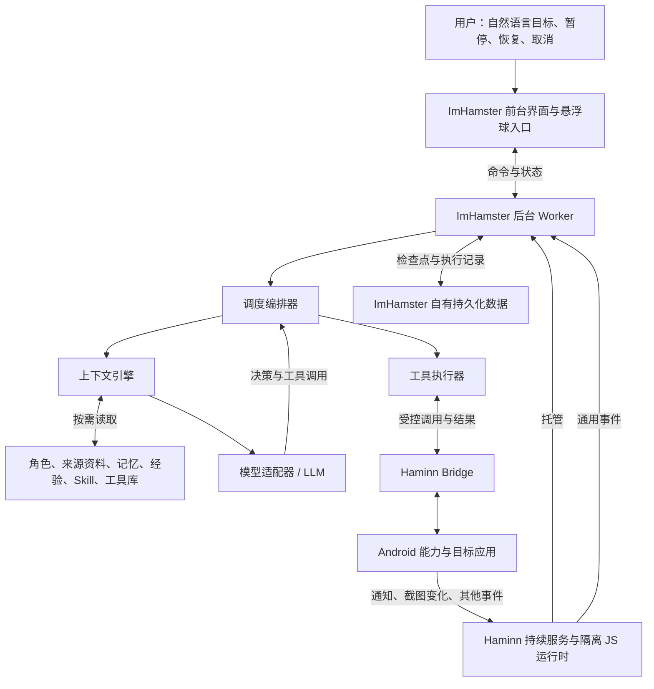

# ImHamster 产品设计 1.1

> 版本：1.1 · 日期：2026-10-10 · 状态：产品与架构设计，待分阶段实现。
>
> 本文按最新产品共识重整 [原产品设计草案](PRODUCT_DESIGN.md)，并根据微信等持续接管场景复核修订。本文中的架构、模块名和新增接口表示目标设计；当前能力与实现差距见第 11 节。接口正式命名、参数和错误码由 Haminn Bridge 合同确定。

## 1. 产品定位与目标

ImHamster 是基于 Haminn 的通用型手机智能体代理。用户用自然语言设定目标，ImHamster 理解目标、组织上下文、拆分与调度任务，通过 Haminn Bridge 使用 Android 能力，持续执行到目标完成、等待条件或出现明确阻碍。

它拥有自己的角色设定，包括人格、自我叙事、经验、记忆和逐步积累的工具库。角色设定长期存在，每个任务按需要选择其中相关部分：机械式操作可以只使用任务信息与工具，重复流程可以加入相关经验，涉及沟通、个人偏好和长期关系时再加入相关角色与记忆。

用户可以同时设置多个独立任务，也可以交给它一个涵盖多方面的综合目标。任务可以立即执行、按时执行或等待事件触发，可以顺序衔接，也可以并行处理。编排器保持极简，复杂目标由模型逐步规划和调整。

### 1.1 典型场景

| 用户目标 | ImHamster 的工作 |
|---|---|
| 接管微信新消息，结合聊天历史与联系人情况自动回复 | 发现消息、定位会话、补充必要上下文、拟写并发送回复、核实结果、更新相关记忆 |
| 定期浏览朋友圈，给指定朋友点赞和留言 | 识别内容与对象，按照用户偏好选择互动，记录已处理内容并避免重复 |
| 整理订阅号与朋友圈中感兴趣的信息 | 浏览、筛选、提炼、去重、归档，按用户要求生成汇总 |
| 逐渐理解每个朋友，以便之后更好地沟通 | 积累有来源的联系人事实、关系背景、交流偏好和待跟进事项，区分事实与推测 |
| 添加符合条件的朋友，围绕指定目标持续交流 | 按目标搜索和判断对象，发起申请，等待接受，再根据上下文推进对话 |
| 一边处理新消息，一边整理资讯并推进其他应用里的任务 | 拆分任务，协调事件、上下文与屏幕使用，在条件变化时调整执行顺序 |

这些场景用于说明通用能力，应用名和流程不写死在编排器中。具体任务由用户目标、模型判断、相关经验与工具共同定义。

### 1.2 产品原则

- **目标驱动**：以用户目标与完成证据组织执行，允许探索、拆分、调整和复用经验。
- **助手优先**：运行期间助手继续推进任务。用户偶尔触摸或切换页面不自动暂停助手；需要自行使用手机时，用户先暂停助手或取消全部任务。
- **按需上下文**：为当前任务提供足够且相关的信息，减少无关人格、历史和工具说明。
- **模型负责判断，程序负责落实**：规划、语义理解、路径选择与中断恢复由模型判断；程序维护状态、资源、工具执行和用户控制。
- **系统能力分层**：ImHamster 拥有智能体逻辑，Haminn 提供通用运行底座与 Android Bridge。
- **持续、可控、可核实**：支持长期运行、暂停与恢复，明确区分动作受理和目标完成。

产品基线是普通 Android APK 与已获授权的系统能力。设备支持、应用开放程度、锁屏、安全窗口和 Android 生命周期仍影响执行条件；无法执行时保存进展并说明阻碍。

### 1.3 可行性与运行条件

上述场景需要的核心闭环是“发现工作 → 读取相关信息 → 理解并规划 → 操作应用 → 核实与积累”。本文架构可以承载这条闭环，微信流程由模型、资料和 Skill 表达；能否稳定完成某项实际操作，仍取决于目标版本的界面、素材可读性、输入效果和设备状态。架构可行与真机能力验收分别判断。

持续运行与持续操作分开：Worker 可以在后台等待和处理资料，屏幕操作通常需要设备亮屏、已解锁且目标应用可进入。接管模式明确显示这些条件，提供系统允许的屏幕状态查询与保持可操作状态的配置；锁屏或不可截图时转为等待，条件恢复后继续。不能把保持 CPU 运行当成屏幕可操作，也不依靠绕过锁屏完成任务。

首版接管基线是在一台满足上述条件的手机上协调多个目标；界面浏览、输入和发送轮流使用同一块屏幕。后台信息整理可并行，跨应用事件通过通知和巡检发现。处理量过大时显示积压与预计等待，不能通过增加模型并发获得多块可操作屏幕。

## 2. 整体架构

采用“前台控制界面 + 一个后台智能体 Worker + Haminn 原生底座”的结构。每个 ImHamster 实例只有一个调度与状态写入主体，各任务共享这套机制。

图中模块是同一 Worker 内的职责划分，可用普通 JavaScript 模块实现；无需为每个职责建立独立服务或独立智能体。

### 2.1 职责边界

| 层 | 负责 |
|---|---|
| 前台界面 | 目标输入、角色与资料管理、任务查看、暂停/恢复/取消、结果展示；通过通用消息接口连接 Worker |
| 调度编排器 | 目标协调与任务单元、依赖与触发、状态流转、运行预算、并行限制、屏幕协调 |
| 上下文引擎 | 按任务检索、选择、压缩和组装上下文，记录实际使用的来源 |
| 模型适配器 | 将统一上下文与工具合同转换为模型请求，规范化结果、错误和用量 |
| 工具执行器 | 校验参数和运行状态、记录调用、执行工具、交付结果；统一经过调度器协调资源 |
| 自有存储 | 用户目标、角色、来源资料、记忆、经验、Skill、工具定义、任务状态、执行记录与检查点 |
| Haminn | 共享持续服务、隔离 JS 运行时、通用消息/计时器/事件、能力发现与授权检查、Android 接口执行 |

Haminn 的 JS 运行时持有通用 Worker 注册、代码版本、资源配额和事件交付信息；任务与上下文内容归 ImHamster。Worker 通过 `haminn.data` 和 `haminn.files` 使用自己的数据空间，底层存储由宿主托管，数据含义与读写策略由 happ 决定。

## 3. Task、OST、EDT 与 AL

统一定义见[术语表](术语表.md)。

用户的语义指令称为 **Task**。Task 可以是立即执行的单次任务（**One-shot Task, OST**），也可以是由事件持续触发的任务（**Event-driven Task, EDT**）。EDT 是长期有效的触发定义；每次事件命中都创建一个独立 OST。复杂 Task 可由 LLM 拆成多个内部工作单元并调度，工作单元不改变用户指令的 Task 身份，也不构成额外的产品任务类型。

**动作循环（Action Loop, AL）** 是 LLM 连续进行观察、判断、单步操作和复核的执行阶段。一个 OST 通常对应一个 AL，但两者不是同一概念：AL 到预算检查点、遇到错误或换路时，可以结束并新建 AL，继续当前 OST。切换或重启 AL 不会重置 OST 的总时限。

每个 OST 默认有 30 分钟软件层面的硬时限，覆盖该 OST 内所有 AL；超过后编排器停止并向用户报告。AL 默认预算为 15 分钟，LLM 在动作前估算并可将预算设为不超过 30 分钟。AL 预算到期只触发 LLM 复盘，不等同失败；LLM 可延长当前 AL、创建新 AL 从现状继续，或以新 AL 重新开始 OST，但始终受 OST 总时限约束。EDT 本身没有 OST 的 30 分钟期限；每次触发创建的 OST 各自计时。

执行职责遵循单一边界：LLM 决定目标拆解、操作内容、换路、恢复和任务验收；编排器只管理 AL 生命周期、OST 时间/额度参数、调度和持久化。编排器不判断 LLM 是否完成目标，只记录 LLM 给出的结论。当前模型额度不设上限。

代码中的 `Goal`、`Task` 与 `runId` 是既有存储/API 兼容名称，不应与上述产品术语混用：旧 `Goal` 记录承载用户 Task/EDT 配置及 OST 执行状态；旧 `Task` 记录表示可选的内部工作单元；`runId` 标识一次 OST 执行尝试。新产品文案和新增接口应使用本节术语，现有持久化字段可在迁移计划明确前保持兼容。

### 3.1 任务拆解与调度

LLM 根据用户 Task 自行决定是否拆分内部工作单元、如何组织依赖、何时等待以及如何恢复。简单 Task 可直接执行；复杂 Task 可以在同一 OST 内安排多个工作单元。无需另设语义规划智能体，也不把工作单元数量或结构变成编排器的业务验收条件。

EDT 保存用户要求的长期触发意图。事件到达后，由 LLM 结合 Task 与事件上下文决定是否触发，以及触发的 OST 要做什么；每次触发建立独立 OST。编排器负责可靠接收、去重和交付事件，但不替 LLM 理解业务匹配、拆分任务或选择处理路线。

LLM 根据其操作历史和当前结果自行判断 OST 是否完成，并记录结论。等待好友接受、后续确认会话、继续交流等跨时段工作，可以由 EDT 的后续事件触发新 OST，或由 LLM 按用户 Task 设计的持续机制继续推进；不能把一次 OST 完成误认为 EDT 已停止。

### 3.2 最小状态

| OST 状态 | 含义 |
|---|---|
| `ready` | 可以运行，等待调度或资源 |
| `running` | 正在完成一个模型/工具执行轮次 |
| `waiting` | 等待事件、时间、依赖、用户补充或设备条件，记录等待原因 |
| `paused` | 用户主动暂停，保留进展 |
| `done` | LLM 判断本 OST 已完成，系统原样记录其结论 |
| `failed` | 软件级 OST 时限/资源硬限制触发停止，或 LLM 报告无法继续；保留原因和恢复信息 |
| `cancelled` | 用户取消本 OST，后续事件是否继续由对应 EDT 状态决定 |

EDT 在某次 OST 完成后仍可等待下一次触发；“本次消息已处理”与“停止此类事件接管”分别表达。内部工作单元、依赖与结果由 LLM 组织，系统保存进展并在后续上下文中提供必要摘要。

## 4. 极简调度编排器

采用一个事件入口、一个串行状态持久化路径和有界的异步模型调用。编排器管理 AL 的启动、复盘、续时和结束，并监督 OST 软件层面的时限及未来配置的额度；LLM 负责 Task 内容、内部工作拆解、操作路线、恢复策略和结果验收。编排器不解释任务语义或验证完成结果，无需通用工作流语言或分布式队列。

### 4.1 调度与并行

- 用户 Task、系统事件、计时器和模型结果经统一入口持久化；事件按稳定标识做传输层去重，不代替 LLM 作业务判断。
- 编排器限制同时运行的 AL 与屏幕 Bridge 调用，持久化 OST/AL 生命周期和用户级时间/额度边界；同一设备同一时刻最多派发一个屏幕动作。
- EDT 在明确暂停或取消前保持启用。一次 OST 结束只结束本次触发，不自动改变 EDT 状态；EDT 的事件频率限制只保护运行资源，不决定业务结果。
- 多个 Task 同时涉及同一消息或内容时，相关上下文与已有操作记录交给 LLM 决定如何协调。系统记录对象和外部操作事实，不替 LLM 选择合并、跳过或执行。

### 4.2 屏幕协调

屏幕是共享资源，一次只允许一个 AL 派发屏幕操作。先用一个屏幕占用标识实现，无需多级锁。

AL 的屏幕操作遵循**获取当前截图 → 模型判断 → 执行单步动作 → 获取结果画面**。每个动作后交回 LLM 评估，编排器只在模型调用及 Bridge 动作执行期间持有必要资源；等待、换 AL 或暂停时释放资源。

浏览、采集和长任务在每个已保存进展的页面/动作边界让出屏幕，使高优先级消息任务及时运行；首版设置连续轮次与占屏时长预算，到达预算后在最近的安全边界交还调度。已经派发的动作以及尚未核实的发送等操作先解决结果，不在其中途切换任务。重新调度时由模型恢复阅读位置和页面，避免为了读完一篇长文章一直占屏。

模型提出的纯资料整理等工作无需占屏；凡是会切换页面、改变焦点、输入或调用能打开页面的入口，都经过屏幕协调。再次取得操作权时获取新截图，不沿用上次留下的坐标、焦点和页面假设。

用户中途操作时，助手保留任务并根据实际画面继续。对于截图决策到动作之间可能发生的明显界面变化，在动作前做必要的本地状态复核；变化使原动作依据失效时重新截图判断。这个检查用于更新执行依据，不把用户操作当成自动暂停信号。截图比较无法完全消除瞬时竞争，因此发送等动作尤其需要核实当前对象与内容。

多个 happ 实例竞争同一设备屏幕时，Haminn 应提供通用的独占使用或明确冲突状态，ImHamster 在此之上调度自己的任务；宿主无需理解这些业务任务。

同一实例也须协调 SCW、动作前复核与普通截图：Haminn 使用共享采样入口限制截图频率，允许复用满足时效的样本。采样间隔过短时返回明确的可重试状态，不能让多个观察任务各自高频截屏。Android [无障碍截图接口](https://developer.android.com/reference/android/accessibilityservice/AccessibilityService#ERROR_TAKE_SCREENSHOT_INTERVAL_TIME_SHORT) 明确可能因间隔过短而失败。

### 4.3 用户控制

- **暂停助手**：保存全局暂停状态，停止启动新轮次和新动作；事件可限量合并留待恢复。恢复后先获取当前状态，再由模型继续。
- **取消全部任务**：停止 Goal 的触发和对应订阅，取消已有 Task，清除尚未派发的动作；已派发动作保留记录与回执。以后新建目标才重新运行。
- **暂停/取消单个目标**：只影响该 Goal 及其任务，其他目标继续。
- 每次异步返回都核对 `runId` 和任务修订号；暂停、取消或目标变更后的旧结果只记录，不继续执行。每个工具调用前再次检查运行状态。

暂停与取消立即阻止后续派发；已经交给 Android 的手势或发送可能无法撤回。界面如实显示最后一个在途动作及其结果，恢复时纳入判断。

## 5. 健全但极简的上下文引擎

上下文引擎只负责**路由、检索、组装、压缩、回写**。角色长期存在，是否加入一次请求由当前工作决定，不必为不同任务复制不同人格。

### 5.1 上下文组成

| 部分 | 内容与加载方式 |
|---|---|
| 基础规则 | 简短的智能体职责、用户目标优先、工具边界与结果要求，每次加载 |
| 当前任务 | Goal 原意、Task 子目标、触发输入、必要的依赖结果、工作摘要与未决事项，每次加载 |
| 当前证据 | 相关的新截图、通知、工具结果与最近关键动作，按当轮需求加载 |
| 来源资料 | 已实际读取的聊天片段、文章、动态与资料页，按对象、时间和主题检索，保留覆盖范围与出处 |
| 人格与自我叙事 | 名称、身份、表达习惯、稳定立场与自我经历，只在相关时加载 |
| 用户与关系记忆 | 用户偏好、联系人事实、关系背景、承诺与待跟进事项，按对象和主题检索 |
| 经验与 Skill | 有效做法、失败教训、适用条件及可复用步骤，按任务检索 |
| 工具说明 | 可用工具的简短目录，选定工具再提供参数与结果合同 |

人格描述 ImHamster 自身；代用户交流时以用户的要求、关系背景和表达偏好为准。模型不把自己的自我叙事套用成用户的经历或立场。

### 5.2 最小上下文策略

每个 Task 保存 `persona: include|omit`、`memory: off|relevant`、`skills: off|relevant|explicit`，以及相关对象、主题和明确指定的资料。工具由任务需求和设备实际能力共同筛选。

| 工作 | 默认上下文 |
|---|---|
| 打开应用、定位按钮、搬运数据等机械操作 | 基础规则、任务、当前证据、所需工具；省略人格与无关历史 |
| 重复操作、恢复失败流程 | 在必要任务信息之外加入相关经验和 Skill |
| 根据历史回复联系人 | 当前对话、相关关系记忆、用户表达要求；人格仅在需要助手自身表达时加入 |
| 讨论助手经历、长期协作、角色化交流 | 加入人格与自我叙事，再检索相关记忆 |

策略可由模型在理解目标时设置，用户可查看和覆盖；执行中遇到新对象或缺少信息时按需追加检索。首轮先用较少上下文，不为判断路由额外固定调用一次模型。Task 整体策略是默认值，具体轮次可以进一步缩减：沟通任务中的机械导航也可以省略人格和已读历史。

### 5.3 组装与压缩

1. 从持久化记录读取当前目标、进展摘要、未决动作和最近结果。
2. 先按对象、应用、时间范围、标签和关键词筛选来源资料、记忆、经验与 Skill，再选取少量相关条目。首版使用结构化索引与文本检索即可。
3. 加入本轮需要的证据与工具说明；当前状态优先于旧经验，来源、时间和适用条件随条目保留。
4. 按模型上下文预算控制大小。优先保留用户目标、最新证据、未决动作和当前对象信息；压缩旧工具输出，减少低相关记忆，较长资料通过文件引用按需读取。
5. 轮次结束更新精简工作摘要，保留已确认事实、当前子目标、已尝试路径和待处理问题；无需把全部历史请求重新发送。

模型可以请求更多相关资料。截图、通知和聊天文字作为有来源的数据输入，不能直接变成更改用户目标或调用权限的指令。工具参数和结构由程序校验，语义合理性仍由模型判断；模型自报的置信度不作为正确性的保证。

### 5.4 记忆与经验积累

采用一套统一条目结构，至少保存类型、关联对象/主题、内容、来源、观察或验证时间和有效状态。通过类型区分关系事实、偏好、经验、Skill 等，无需为每类单独建一套检索系统。

- 联系人身份先以实际会话与已确认资料关联；同名、改名或身份不明时保留歧义，不把两个朋友的历史自动混在一起。
- 关系记忆可以在任务执行中更新，不限于任务完成后；把可见事实、用户明确说明与模型推测分开保存。新证据冲突时更新或标记旧内容，不将推测当成确定事实。
- 完成任务或遇到有价值的失败后，提炼必要经验。可复用做法附上前置条件、结果依据和失败边界；形成 Skill 时记录版本和适用范围。
- 自我叙事由已发生的经历和明确角色设定组成，避免把模型临时生成的故事记为真实经历。
- 用户能查看、编辑、删除人格、记忆、经验和 Skill。删除后使对应缓存失效，不从旧工作摘要自动重新导入；受影响的任务重新组装上下文。

长期保存提炼后的必要信息。当前任务需要的草稿和对话片段可以按需保存用于恢复，结束后按留存设置清理；截图默认短期使用，凭证不进入经验库。语义向量检索仅在现有检索效果不足时增加。

### 5.5 来源资料与信息采集

来源资料与提炼记忆使用同一自有存储，但用途不同：资料保留实际读到的内容与来源，记忆提供适合复用的事实和摘要。聊天历史回复、文章汇总和关系理解都应能回到相关资料，不能只依赖不断压缩的任务摘要。

- **会话资料**：关联账号、联系人/群、发言者、可见时间与顺序，记录已读范围、最后已处理位置、未回应内容和已核实发送结果。目标应用未暴露稳定消息 ID 时使用本地标识与邻近上下文，重复的“你好”等短文本不直接判为同一条消息。
- **长内容采集**：边滚动边提取，保留相邻页面的重叠锚点，去重后追加内容与阅读位置；到达末尾、指定范围或预算时记录覆盖情况。长文章与聊天历史都可以跨调度轮次继续。
- **关系资料**：按任务需要读取相关对话、动态和资料页，再提炼事实、偏好与待跟进事项。首次接管只有已有可读信息，模型可以增量补充相关历史，不默认已经掌握所有朋友和全部历史。
- **内容结果**：资讯条目保存来源、作者/账号、时间、标题、正文或摘要及必要引用；朋友圈互动保存相关条目与动作结果。没有稳定内容链接时保留来源描述、内容锚点与必要证据。

当前屏幕不足以回答时，模型选择继续查找相关历史或明确说明资料范围；采集到部分内容只能生成对应范围的汇总。微信语音、图片或视频仅在当前能力能够读取、转写或提取所需信息时纳入理解；按需语音识别能力不等于能直接取得其他应用收到的语音文件。不可读取的素材保留未处理标记，由任务决定后续路线。

资料留存跟随用户目标设置：一次性资料可短期保存，承担长期关系理解和历史回复的相关资料可持续增量留存，用户能查看与删除。资料更新通过 Worker 串行提交；会影响当前回复的更新使对应上下文重新组装。

## 6. 工具库与动作循环（AL）

### 6.1 工具分层

- **Bridge 工具**：将 Haminn 已公开的能力适配成模型可调用的工具，如截图、点击、滑动、输入、系统导航、网络、语音、位置与传感器。
- **ImHamster 内部工具**：检索记忆、读取进展、拆分任务、设置等待、保存资料和更新经验。
- **组合工具**：在已有工具之上封装经验证的重复工作，包含输入、前置条件、执行逻辑和结果要求。
- **Skill**：告诉模型何时、如何使用这些工具的程序性知识；可以复用，也允许根据当下状态调整。

工具条目至少有名称、用途、输入合同、所需能力、是否占用屏幕、是否产生外部动作和结果合同。组合工具的所有底层调用仍经过同一工具执行器，不能绕过暂停、屏幕协调或 Bridge 授权。

首版优先积累参数化做法和 Skill，成熟的重复逻辑再提炼为普通 JavaScript 组合工具模块。新代码工具记录版本与验证结果，先在适用任务中核实，再进入常用库；工具库由这些实际能力逐步增长。无需引入插件市场、通用脚本语言或自动生成任意代码的执行系统。

### 6.2 模型与程序的分工

AL 中的 LLM 可以选择调用工具、拆分/调整内部工作单元、等待条件、请求必要补充、报告 OST 完成或说明无法继续。这些选择采用统一结构；模型支持原生工具调用时直接适配，否则使用可校验的结构化 JSON，不保留两套编排逻辑。

程序校验输出结构、参数范围、当前 OST/AL 生命周期、用户配置的运行上限与工具授权，记录调用意图后执行工具，将结果交回模型。LLM 决定下一步以及 OST 是否完成；程序不维护微信、朋友圈等业务流程状态机，也不复核语义结果。

一份可读画面可以同时提取多条相关消息或动态，随后批量更新资料；有明确前置条件与结果检查的机械步骤可以交给组合工具完成，条件改变时返回模型重新判断。这样减少重复模型调用，同时保留对当前界面的核实，不依靠一串过期坐标快速点击。

### 6.3 能力通道

按目标选择最可靠且可核实的通道：

1. 有明确 Bridge 合同的原生能力。
2. 目标应用真实支持的 Intent、深链、快捷方式、通知入口或动作。
3. Haminn 将来公开的有限控件树与节点动作。
4. 截图理解与拟人式点击、滑动、输入和系统导航。

这些通道全部通过 Haminn Bridge 或既有授权网络能力使用。不要求逐级机械尝试；发现不支持就换合适通道。能力发现先给模型简短目录，需要时再加载详细合同。

屏幕动作以最新画面为依据，重要动作后重新观察。直接接口有明确完成结果时采用该结果；仅返回 `accepted` 的调用仍需要核实。无法判断的结果记录为未确认，交给模型选择检查路径。

### 6.4 阅读与操作的截图质量

低分辨率变化检测、整屏导航和密集文字阅读采用不同截图策略。SCW 可以用小样本做本地比较，导航使用足够辨认目标的整屏，读取聊天/文章或核实完整草稿时按需获取清晰原图或区域图；保留原始尺寸、区域偏移与缩放关系，点击坐标始终换算回整屏。

Haminn 截图接口需要支持文件引用返回及按需清晰输出，使较大图片经受控文件/网络通道交给模型；不为了满足单条 Bridge 消息的限制而一直压缩到文字不可读。先读取工具合同确认可用格式，具体参数由 Bridge 定义。密集文字仍无法辨认时重新取样或调整界面，不把模糊识别结果写成确定事实。

首版可完全通过截图模型采集文字，有限控件树或设备端 OCR 是有需要时的加速手段。当前证据不足以核实完整长草稿时，可以分段查看或采用更清晰的相关区域，由模型综合核实后发送。

## 7. 事件与持续观察

事件只是任务触发输入，由 ImHamster 决定匹配哪个 Goal、是否创建 Task 和如何继续。没有匹配目标的事件不自动启动新业务行为。

### 7.1 通知与时间

通知监听优先用于发现应用在后台发出的消息；事件提供系统实际可见的来源、标识、时间、标题/摘要和入口。通知可能合并、隐藏正文或未发布，不能视为完整聊天历史。模型根据需要打开目标会话读取相关内容。

同一通知反复更新先合并，通知与截图发现的同一消息在获取会话证据后归并；通知标识不作为聊天消息唯一标识。保存已处理对象与内容的必要标记，发现不确定的重复时让模型核实。

通知、SCW 和主动巡检共同构成消息发现闭环。模型从用户目标建立巡检范围与间隔；通知接收有效也保留低频的目标范围巡检，防止无通知、通知已清除或其他客户端已读导致遗漏。巡检关注实际会话与未处理内容，未读角标只提供线索。首次接管明确从当前积压还是从接管后的新内容开始，任务中保存边界，不把整段历史当作待回复消息。

联系人连续发来多条消息时可以短暂合并成一次回复任务，合并等待有上限；发送前重新查看当前会话及已处理位置。群聊区分发言者与用户指定的回复条件；自己发出的消息更新用于核实结果，不自动触发回复自己的新任务。

通知入口可用时经屏幕协调直接打开；没有入口或入口失效时采用画面导航。若任务和通知动作适配，模型也可以使用通知实际提供的回复能力并核实结果。

计时器唤醒任务，时间到达后重新检查目标与当前状态。系统延迟或 Worker 中断后按 Goal 策略补做一次、合并或跳过，不将遗漏的每个采样点全部重放。通知访问由 Android 的 [NotificationListenerService](https://developer.android.com/reference/android/service/notification/NotificationListenerService) 提供，需用户在系统设置开启。

### 7.2 截图变化监听 SCW

SCW 在设备端采样和比较截图，只在变化达到条件或需要周期复核时交给模型。像素变化是观察信号，变化的业务含义由模型理解。

首版原生观察能力包含：整屏或 1–8 个归一化区域、区域变化阈值、`any/all` 合并、采样间隔、连续命中次数、冷却时间，以及启动/查询/停止。周期模型复核由 ImHamster 调度；`reviewEvery` 表示未变化后的复核间隔，与连续变化命中数分别表达。

观察定义保存目标页面、区域、规则及其对应 Goal。截图前暂时隐藏 Haminn 管理的悬浮球，成功、失败、取消都恢复显示。触发时保留有期限的画面文件引用、采样时间和场景修订信息，事件只携带这些小型元数据；延迟处理时仍能知道触发时显示了什么，真正操作前另取当前画面。

有效基线保留到模型复核或场景重新建立，不在每个未触发样本后无条件替换，避免缓慢变化一直低于单次阈值。冷却期间合并变化并保留最近触发画面，文件过期时报告证据已失效，不将另一页面的新截图冒充原事件证据。

**SCW 观察的是当前实际显示的屏幕。** 长期等待不永久占屏：其他任务使用屏幕后，原区域不能继续被解释为原页面上的消息变化。调度器暂挂依赖该场景的观察，待重新进入目标页面并取得新基线后恢复。用户临时切换页面引起变化时，模型先确认实际场景，再导航回目标或调整观察。

因此，跨应用接管优先通过通知发现后台事件，再结合按计划巡检；SCW 用于当前可见场景的低成本观察。无通知时的定期浏览由任务自身安排，不能承诺同时观察多个不可见应用。

底层监听随任务停止释放资源，可配置采样频率、冷却与触发上限；持续模式由用户任务决定，不强制每天重新开启。设备截图限制、屏幕关闭或安全窗口不可截图时报告真实状态，保留任务并等待条件恢复。

### 7.3 语音与其他触发器

按需语音输入使用 Haminn 已有识别能力，文字结果进入同一目标入口；语音输出使用 TTS。热词检测单独发现与启停，只有设备实际开放且用户开启时提供低功耗唤醒。普通持续语音识别不作为热词缺失的自动替代；Android [SpeechRecognizer](https://developer.android.com/reference/android/speech/SpeechRecognizer) 对连续使用提示了耗电与带宽问题。

显著运动等系统触发器也通过通用事件接入。`TYPE_SIGNIFICANT_MOTION` 按设备支持情况提供，由 Haminn 管理一次性注册与需要时的重新注册；它表示显著运动，不直接等同于“摇一摇”。见 Android [传感器合同](https://developer.android.com/reference/android/hardware/Sensor#TYPE_SIGNIFICANT_MOTION)。这些入口可后续增加，不阻塞核心代理闭环。

## 8. Haminn 持续服务与后台 JS 运行时

长期运行依赖 Haminn 建设共享原生持续服务，在其中托管各 happ 实例相互隔离的 JS Worker。服务有效时，前台页面关闭、切到其他应用或界面重新加载不终止 Worker；前台仅重新连接并显示状态。

这个共享服务是 Worker 的唯一生命周期持有者；无障碍服务、通知监听等 Android 要求的组件仍按系统合同独立实现，通过宿主内部接口提供输入与操作。某个系统组件断开时报告相应能力不可用，不能把“Worker 仍在运行”显示成“所有能力都正常”。

### 8.1 最小运行时合同

| 能力 | 首版要求 |
|---|---|
| Worker 注册与生命周期 | 绑定实例与代码 release，启动、停止、查询状态；同实例同入口幂等，更新时停止旧版本再加载新版本 |
| JS 执行环境 | 明确支持的 JS 版本，支持 Promise、JSON、受控计时器与事件回调；不依赖 DOM、`window`、Canvas 或页面闭包 |
| Bridge | 提供适用于 Worker 的通用调用与事件接口；原生校验实例、release 与 Worker 会话，复用实例授权和公开能力合同；不依赖 WebView 页面会话 |
| 前后台通信 | 实例内命令/状态消息与请求标识；Worker 是任务状态的唯一写入主体，页面不启动第二个执行循环 |
| 事件交付 | 通知、截图变化等携带事件标识、来源、发生时间与必要引用；短期有界缓存，Worker 持久化接收记录后确认，宿主再释放 |
| 资源控制 | 内存、单段 JS 执行时间、计时频率、网络并发上限；可中断失控脚本、单独停止异常 Worker |
| 通用存储 | Worker 可使用实例自有 `data/files`；用户数据独立于代码 release，实例更新保留授权和数据 |

运行时采用可嵌入原生服务的 JS 引擎。工程选型先验证 Promise/事件桥接、执行中断与内存上限，不以隐藏 WebView 保活替代正式后台合同。JS 模块随 happ release 打包，运行环境由 APK 提供，基础运行无需在线下载引擎或依赖 GMS。

宿主事件采用允许重复交付的简单机制，ImHamster 按标识去重并持久化待处理项，模型处理不阻塞原生接收。队列过期或溢出时提供遗漏标记；Worker 恢复后由模型结合通知快照和必要巡检补充当前信息，不声称能还原全部遗漏消息。暂停时也只做有界合并，取消后停止相应订阅。

目前基于 Canvas 的截图对比应迁移为原生图像比较原语；模型请求、上下文与调度保持普通 JS。需要界面的授权设置或交互提示经 Haminn 原生入口发起，无法后台打开时返回明确状态。

### 8.2 服务生命周期

用户启动 Haminn、happ 或悬浮球时，在常驻开关有效且系统允许的情况下幂等确保共享服务运行。持续通知提供运行状态与停止入口；ImHamster 另展示自己的任务状态。服务空闲时等待事件，不维持无必要的高频截图循环。

Android 前台服务必须符合 [后台启动限制](https://developer.android.com/develop/background-work/services/fgs/restrictions-bg-start) 和实际用途对应的 [服务类型、权限及限制](https://developer.android.com/develop/background-work/services/fgs/service-types)。共享服务存在不意味着截图、麦克风等能力自动可用；不能用普通数据同步服务类型承诺无限期运行。

常驻代理底座需在第一阶段完成类型选型：优先评估用户主动开启、持续可见的代理运行是否符合 `specialUse`，按真实用途声明权限与服务子类型说明，并验证目标 Android 与分发要求；这是一条候选实现路径，不代表仅声明类型就能保证常驻。`dataSync` 在现代 Android 上有 [运行时限](https://developer.android.com/develop/background-work/services/fgs/timeout)，现有分享/备份服务不能直接承担无限期 Worker。截图继续使用已获授权的无障碍截图通道，无需把整套代理伪装成媒体投屏服务。

Worker 等待事件时允许设备休眠；活跃模型/工具轮次所需的 CPU 保持由宿主短时按需管理，并在轮次结束释放。屏幕可操作状态单独管理，后台等待期间收到通知可以先入队，锁屏状态下等待可执行条件。后台 JS 引擎、Bridge 调用会话和事件投递都必须独立于页面生命周期，不能只搬一份页面脚本到服务中。

进程被结束、设备重启或服务恢复后，Haminn 重新建立仍有效的通用 Worker 与系统订阅；ImHamster 读取自己的目标和进展，决定恢复工作。启动被系统拒绝时显示等待用户启动。用户强制停止服务后尊重停止状态，再次主动启动时恢复；不承诺永不退出或实时调度。

悬浮球命令由原生入口交给有效 Worker，页面不存在时仍可查看任务与发出暂停/取消。控制命令优先处理，不等待在途模型请求结束；如果 Worker 失控，Haminn 提供独立的停止入口并回收其运行资源。页面重新连接不再次注册一套监听或启动第二个编排循环。

## 9. 状态保存与模型主导的恢复

恢复目标是让模型拿到足够的真实进展与最新状态，决定继续、补做、调整、结束或请求补充。程序提供通用记录和查询，不为每类业务编写专用恢复算法。

### 9.1 最少保存的数据

- Goal 与 Task：目标、关系、触发、启停状态、上下文策略、预算、当前工作摘要和待办。
- 最近执行记录：工具名称、必要参数、意图、时间、回执、账号与对象、内容标记、相关证据引用、错误与未确认结果；对象处理记录跨 Goal 共享。
- 待决动作：当前对象、必要的发送草稿/内容、操作标识及其已知状态；跨中断仍能区分准备调用与已核实完成。
- 事件与检查点：已接收/处理的事件标记、运行标识、代码版本和任务修订号。

结构化记录使用 `haminn.data`，图片与较长材料使用 `haminn.files` 引用。关键任务状态和操作意图通过现有 `data.batch` 原子保存，写入确认后才派发外部动作；关键保存失败时进入等待，不继续执行无法追踪的动作。Worker 串行处理状态写入，前台编辑也经消息提交给 Worker；运行中的上下文保存所用条目的修订信息，相关资料变更后按需重建。普通诊断记录可以限长清理，未决动作和有效检查点保留到结果解决。

记录状态只需表达 `prepared`、`accepted`、`verified`、`unknown` 或 `failed` 等已知事实。宿主能查询操作状态时取得回执，但没有回执不等于动作没发生。

`verified` 记录具体核实到的层级：聊天出现发送结果不代表对方已阅读，好友申请已提交不代表已被接受，点赞/留言入口点击不代表互动成功。恢复时保留对象、内容、前后证据与结果层级供模型判断；点赞等切换型动作尤其不能用重复点击作为通用重试。

### 9.2 恢复流程

1. 读取目标、任务进展与待决动作，确认目标仍启用且助手未被用户暂停或取消。
2. 重新发现所需能力，读取可获得的回执；占用屏幕的任务取得操作权后获取当前画面。
3. 将“为什么中断、已知进展、结果不确定的动作、当前证据”交给模型。
4. 模型决定后续检查与执行，调度器通过正常工具循环落实并更新记录。

例如发送时退出，恢复后模型可检查会话里是否出现对应消息；证据证明未发送时再决定发送，已发送则推进后续工作，无法核实时保留未确认并继续寻找证据或请求必要补充。**不确定动作不因超时自动重放**，但也不把整个目标永久停止作为默认恢复方式。

网络或截图暂时失败可做有限退避重试；已经可能改变外部状态的工具调用不进行透明重试。模型对业务恢复负责，程序落实“已暂停不再派发、同一动作不并发执行、未知结果进入核实”等通用规则。

## 10. 能力授权与用户任务意图

权限与任务目标分别记录，使用时直接结合：

- **Android 系统授权**：无障碍、麦克风、通知访问等由用户在系统允许的入口授予。
- **Haminn happ 授权**：ImHamster 实例获得截图、操作、网络等能力后持续有效，直到用户在 Haminn 撤销；每次 Bridge 调用仍检查当前状态，不重复询问已有效的授权。
- **用户任务意图**：用户设定“自动处理消息并回复”“给指定朋友点赞留言”等目标，即明确了范围内后续行为，无需逐条重新确认。未指定逐字回复时，模型按任务要求与相关上下文拟写。

监听事件不会扩大原目标；存在匹配的自动处理任务时，可以直接推进其已设定行为。只有目标、对象、行为范围存在影响执行的歧义，遇到范围之外的动作或缺少系统授权时才请求补充。能力授权不增加人为期限；任务运行限制来自用户设置与资源预算。

撤销权限使相关工具立即不可用，任务保存进展并等待重新授权或选择其他通道。截图与资料发往模型前，用户应知晓接收方及发送范围；更换接收方或明显扩大数据范围时更新说明。目标应用内容是任务资料，不能自行获得控制权限。

## 11. 当前基础与收敛实施顺序

### 11.1 当前基础

以本轮检查的 [ImHamster 源码](../app.js)、[使用说明](../README.md) 与 [Haminn 能力清单](../../haminnapp/api/capabilities.json) 为准：

- ImHamster 已有悬浮球语义目标入口、模型连接检查、单步截图决策、Bridge 操作、后续截图复核和短任务工作摘要。
- 活动任务内已有区域截图对比与观察原型，使用页面 Canvas，支持 `any/all` 和未变化周期复核；当前不具备独立后台监听生命周期。
- 当前 ImHamster 截图默认最长边 800，超限时降低到 640；宿主 `interaction.capture` 以内联 Base64 返回，并限制压缩后图片大小。该路径可作现有导航基础，密集文字阅读的清晰文件输出仍需建设。
- 系统导航已有操作标识与回执查询，页面保存限长诊断轨迹；尚未保存足以恢复完整业务任务的目标、草稿和长期上下文。
- Haminn 已公开截图、拟人操作、有限系统导航、语音、原始传感器与数据/文件等能力；现有 `notifications` 是通知发布与计划接口，不是其他应用通知监听。
- 共享后台智能体服务、HAPP 后台 JS Worker、原生 SCW、其他应用通知监听、热词与显著运动专用事件尚待建设；ImHamster 的多任务编排、角色记忆与工具积累也待实现。

当前 [HaminnApp 开发总则](../../haminnapp/AGENTS.md) 明确不提供 happ 后台 JavaScript。本文提出将其演进为通用、隔离、受控的运行能力；进入宿主实施时，应先同步这一产品边界与正式合同。本文本身不表示该能力已经存在。

### 11.2 实施顺序

| 阶段 | 交付范围 | 完成标准 |
|---|---|---|
| 1：建立可操作的持续底座 | 核实服务类型与设备运行条件；Haminn 共享服务、隔离 Worker、后台 Bridge、清晰截图文件通道、实例内通信；ImHamster 通用任务循环、检查点与用户控制 | 在亮屏解锁条件下完成真实会话阅读、输入、发送与核实；离开 happ 页面后继续执行，中断后模型恢复 |
| 2：形成完整代理闭环 | Goal 协调与 Task、多任务调度与屏幕让出、最小上下文引擎、来源资料、角色与关系记忆、经验/Skill/工具目录 | 多个目标可以衔接或并行处理；长阅读可中断续做，历史回复读取相关资料，同对象不会重复处理 |
| 3：支持日常持续接管 | 通知监听、原生 SCW、目标范围巡检、事件合并与持续目标管理 | 有通知与无通知时均能发现范围内待办；新消息与资讯整理协调运行，停止或取消后不被后续事件重启 |
| 后续按需 | 应用入口、有限语义节点、成熟组合工具、可用设备上的热词与其他触发器 | 对已证明的瓶颈补充能力，保持相同编排与工具合同 |

这三个阶段共同组成目标版本的核心能力，不把页面内原型当作持续代理已完成。第一阶段先解决实际设备上的运行与操作链路，避免先写完整记忆系统才发现基础截图或持续服务不可用。每阶段先验证一个完整链路，再扩大任务种类。模块先用普通 JS、现有存储与少量索引实现；不预建多智能体团队、分布式调度、复杂工作流 DSL 或多套记忆后端。

## 12. 贯穿场景与验收

用户设定：“持续处理指定联系人的微信消息，结合历史自然回复；每天整理关注的订阅号内容；浏览朋友圈时为指定朋友做合适互动。”

1. ImHamster 记录综合 Goal，由协调任务建立触发与具体工作，明确接管起点并显示范围。
2. 通知、SCW 或巡检发现待处理内容，唤醒或合并会话任务，检索当前联系人资料；任务取得屏幕操作权，打开会话并读取必要历史。
3. 模型生成符合用户要求的回复，核实对象与内容后发送，再检查结果；新的消息更新已到达时重新考虑待发送内容。
4. 对话中的新事实形成有来源的关系记忆；实际操作经验按需保存，后续机械导航只加载相关工具与经验。
5. 资讯整理边采集边保存资料与阅读位置，在安全边界让出屏幕给新消息，重新调度后续读；朋友圈任务在合适的轮次执行，不交叉抢占输入。
6. 用户偶尔切换页面，助手依据实际画面继续；用户暂停后停止新增动作，恢复后重新判断当前状态。
7. 运行中断后由模型结合记录和画面续做；取消全部任务后，旧模型结果和新通知都不会重新启动这些目标。

验收聚焦：语义目标能落实为任务、页面关闭后执行继续、上下文可解释且按需加载、屏幕与会话不发生内部竞争、中断后能依据证据恢复、长期记忆支持后续工作、用户控制可靠生效。任务完成必须有对应工具或画面证据；不可完成的条件明确报告并保留进展。

### 12.1 微信场景覆盖与验收边界

| 场景 | 必需闭环与关键验收 |
|---|---|
| 新消息自动回复 | 通知/SCW/巡检发现 → 核实会话、发言者与处理边界 → 读取相关资料 → 回复与核实。连续多条消息、无通知、自发消息和同名联系人都不产生错回或重复回复 |
| 根据历史与朋友情况回复 | 检索关系记忆与已采集资料 → 按需补读相关历史 → 根据可核实上下文拟写。首次接管资料不足时不会捏造熟悉程度，机械导航轮次省略无关角色 |
| 朋友圈点赞留言 | 逐条浏览识别对象与内容 → 判断用户范围及已有互动 → 操作并核实 → 保存条目标记。重新浏览与中断恢复不会盲目重复点击点赞或重复留言 |
| 订阅号/朋友圈收集整理 | 分段采集并保留来源与覆盖范围 → 去重归档 → 汇总。长内容能让出屏幕并续读，部分采集不宣称全文已读 |
| 理解与持续维护朋友资料 | 对话/动态/资料页增量采集 → 有来源的事实与推测分开 → 后续任务检索使用。身份或资料冲突能保留歧义，用户编辑删除后不继续使用旧缓存 |
| 加好友并开展目的性交流 | 找到符合条件对象 → 申请并核实 → 等待接受与巡检 → 确认会话 → 根据目的和回应持续调整。等待可以跨天，申请成功不被当作整个目标完成 |
| 多目标综合接管 | Goal 协调汇总任务结果，任务按对象串行、按资源并行；屏幕在安全边界轮换。浏览文章时新消息能取得执行机会，取消后旧回调不再行动 |

这些是架构验收要求，不是当前真机验证结果。每条场景先在实际微信版本上取得完整证据，再标为该环境已支持；应用界面变化后由新截图、更新 Skill 和必要的通用工具修正。受限搜索、不可读素材、应用拒绝操作或锁屏等条件明确记录，不能据此承诺所有日常功能在任何状态下都能自动完成。

日常可用性还要记录事件发现延迟、一次处理耗时、屏幕占用、模型调用量、积压与重复/误处理情况，按目标设备上的实际结果选择采样间隔和预算。模型并行数与屏幕轮换只改善资源使用，不能预先保证即时回复或大量会话的处理吞吐；这项边界随真机数据明确。
