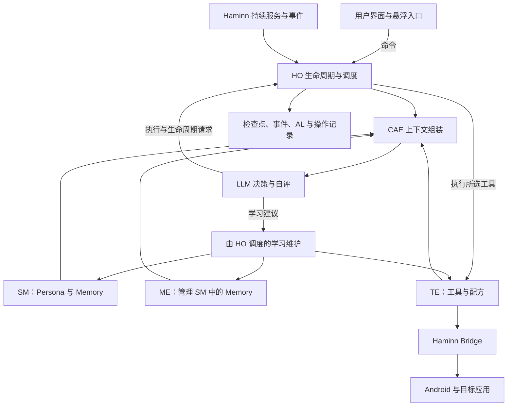

# ImHamster 产品设计 1.1

> 更新：2026-10-11 · 状态：目标设计，分阶段落地。
>
> 本文依据当前产品共识重整原草案，并统一 OST、EDT、AL、HO、CAE、SM、IC、BP、ME、TE。模块与能力描述是目标架构，不能作为当前实现完成的证明。术语以[术语表](术语表.md)为准；代码差距、开发顺序与验收见[开发升级计划](../plans/DEVELOPMENT_UPGRADE_PLAN_2026-10-11.md)。

## 1. 产品目标

ImHamster 是依托 Haminn 持续服务和 Android Bridge 的通用手机智能体代理。用户用自然语言设定单次或持续任务，ImHamster 按需要组织上下文，由 LLM 观察、思考、操作并自行评价结果；在出错时反思和换路，持续推进到完成或明确阻碍。

它具有自己的 SM：稳定的人格核心、可调整的行为模式，以及不断积累的记忆和经验。工具库随实践积累。机械操作只需目标、当前状态、工具和相关经验；沟通、长期关系和自我表达才加载相关角色信息，不要求每次动作携带完整人格和全部历史。

典型任务包括：微信新消息自动回复、根据历史和联系人记忆进行交流、朋友圈点赞留言、订阅号和朋友圈信息整理、逐渐理解朋友、加好友并围绕目标推进交流，以及其他应用中的单次或持续操作。具体业务策略由用户指令和 LLM 决定，HO 与 Haminn 不内置微信业务规则。

产品原则：

- **模型主导内容**：LLM 决定拆解、路线、恢复与验收；程序管理生命周期、数据、工具和软件边界。
- **坚持推进**：暂时出错优先恢复和换路；避免机械重复，用历史、经验和工具提高效率。
- **助手优先**：运行期间用户偶尔触摸或切换界面不自动暂停。用户通过明确暂停或取消交还控制权。
- **积累可追溯**：任务、操作、观察、模型结论、Memory 和工具之间保留来源关联。
- **设计收敛**：一个后台 Worker、一条状态写入主路径、普通模块与宿主存储，不引入多智能体体系、额外服务或专用工作流平台。

## 2. 整体架构与职责

图中职责在同一 Worker 内实现。SM 是数据模型，不单独建立引擎或运行服务。ME 管理 SM 中的 Memory，TE 的工具库独立于 SM。宿主托管存储与能力，数据语义属于 ImHamster。

| 模块 | 职责 | 边界 |
|---|---|---|
| HO | EDT/OST/AL 状态、事件交付、排队、时间/额度、资源协调、恢复入口和维护调度 | 不理解业务是否完成，不自己挑选操作策略 |
| CAE | 按调用目的组装任务、观察、历史、Persona、Memory、工具，控制上下文体积并记录来源 | 不承担任务调度，不每次加载全部资料 |
| SM | Persona 与 Memory 的持久模型，提供 IC/BP 的读取和版本管理 | IC 不由自主学习改写；Memory 的管理交给 ME |
| ME | Memory 检索、归档、更新、去重、遗忘与来源维护 | 内容含义由 LLM 判断，不把原始日志全部变成记忆 |
| TE | 工具注册、检索、配方存储、参数检查与调用 | 不执行任意模型生成代码，不替 LLM 判断任务成功 |
| 模型适配器 | 统一请求、响应文件、错误、取消、用量和决策格式 | 所有调用目的共用一条处理路径 |
| 前台 UI | 指令、进展、结果、日志、角色管理、暂停/恢复/取消/重试 | 向 HO 发命令，不直接改运行状态 |
| Haminn | 持续服务、隔离 JS 运行时、通用事件/计时、网络、存储、截图、拟人操作等 | 不持有 ImHamster 的任务语义或联系人模型 |

## 3. Task、OST、EDT 和 AL

Task 分为立即执行的 OST 和事件驱动的 EDT。EDT 可由通知、时间、可见界面变化或内部事件触发；每次命中产生独立 OST。LLM 负责需要理解的触发匹配和执行内容，明确的包名、时间、事件标识等可由程序机械过滤。

OST 保存一次执行的意图、计划、进展、截止时间与结果。复杂任务的工作单元保存在计划内，由 LLM 组织；HO 执行其提出的调度请求，不增加一套业务规划器。

AL 是 OST 内连续观察与操作的阶段，通常只有一个，恢复和换路时可以有多个。一个 AL 可以包含多次模型请求和很多动作，也可以只处理资料或反思。AL 结束本身不表示 OST 完成。

### 3.1 时间与额度

| 管理对象 | 默认规则 | 到界后的处理 |
|---|---|---|
| OST | 首次开始执行起 30 分钟硬时限；排队不计入，模型调用、短等待和恢复计入；暂停不重置截止时间 | HO 强制停止后续调用和动作，记录 `time_limit`，报告用户，可重试为新 OST |
| AL | 默认预算 15 分钟；开始前由 LLM 估算，可调整但单次预算不超过 30 分钟和 OST 剩余时间 | 提供操作历史和剩余时间，让 LLM 复盘并选择继续、换 AL 或从头尝试 |
| EDT | 监听定义无 OST 总时限 | 每次触发的 OST 独立计时；某次失败不自动关闭 EDT |
| 模型额度 | 暂不限制，记录实际用量 | 将来可配置软件上限，不用隐含的模型调用次数冒充任务额度 |

延长或更换 AL 均不能移动 OST 截止时间。新的 OST 必须来自新指令、有效事件触发或明确重试，不能自动复制超时任务以绕过限制。等待好友通过、下一条消息等跨时段条件应转为 EDT 的后续触发，而非长期占住一个 OST。

暂停保留原截止时间，恢复时先检查它；已超时的任务提供重试入口。这一规则与当前绝对截止时间语义一致，未来改变暂停计时须显式修改产品规则。

### 3.2 最小状态

- OST：`queued / running / waiting / paused / completed / failed / cancelled`。`waiting` 保存原因、恢复条件和已有截止时间；它不是自动失败。
- AL：`active / suspended / reviewing / closed`，结束原因分别记录完成、换路、预算复盘、异常等。
- EDT：`enabled / paused / disabled`；订阅故障另记运行健康状况，不把暂时不可达改成取消。

任务完成由 LLM 根据操作历史和最终观察自评，记录结论、摘要和证据引用。HO 校验结论格式后保存，不另外设置发送按钮关键词、视觉成功分数或业务验收器。软件时限、授权与存储错误仍由程序监督；用户与开发验收者可以检查模型结论是否可靠。

## 4. HO 的运行机制

HO 是唯一的生命周期写入主体。UI、宿主事件和工具结果都通过有标识的命令/事件进入，事件先持久化再处理。状态更新使用修订号与原子批次，避免重复触发、丢失任务和旧结果覆盖新状态。

### 4.1 一轮执行

1. HO 选择可运行 OST，恢复检查点，检查硬时限、权限与资源。
2. CAE 为计划、动作或恢复等当前目的组装上下文，模型适配器发起 LLM 请求。
3. LLM 返回动作、补充上下文请求、等待、复盘、换 AL、完成或求助等决策。
4. HO 处理生命周期请求；TE 检查工具参数，保存操作意图，调用 Haminn，将结果与必要观察交回 LLM。
5. 保存进展和关联记录，释放不再需要的资源，以后续事件继续；不会在一个宿主事件里无限串行执行。

宿主长请求、等待和工具操作以可关联的异步结果返回，不能堵塞暂停、取消和到期控制。每次推进都可让出执行权；运行时的执行时间片耗尽是正常续调度，不是任务失败。

### 4.2 调度与屏幕

首版使用一个模型请求槽与一块屏幕的串行交互，保留有限资料处理并行的扩展点。HO 按用户控制、执行续调度、事件 OST 和低优先级维护工作安排队列，不以无限并发掩盖积压。

屏幕占用覆盖“观察 → 模型判断 → 相应动作 → 复核”这一轮，防止另一个 AL 在截图和动作之间切换页面。轮末释放；长等待释放；新一轮重新观察。助手之外的人工操作仍可能改变界面，LLM 通过新观察纠正，不把界面漂移直接判为失败。

共享屏幕协调由 Haminn 在设备能力层提供，HO 负责申请和让出。资料整理及数据学习不占屏幕。高积压时显示待处理数量，按 LLM 提出的业务优先级或用户设置调度。

### 4.3 用户控制

暂停立即关停后续动作入口并暂停调度，保留任务和检查点；取消使相应任务终止并撤销订阅/待执行动作。已经交付 Android 的动作不能假定可以撤回，其结果仍记入历史。

恢复沿用同一 OST、截止时间和 AL 记录，由 LLM 根据现状继续。重试创建关联原任务的新 OST，由 LLM 选择从现状还是从头尝试。待帮助状态清楚显示阻碍、最后进展和可用操作，用户补充信息后继续，不要求重新输入整个任务。

## 5. CAE：按需上下文组装

CAE 共用于计划、动作、恢复、预算复盘、事件匹配和学习。它组装的是当前调用需要的上下文，而不是固定的大段角色提示词。

基础上下文始终包括：任务意图、当前 OST/AL 进展、软件边界、相关工具合同和最新结果。按需加入：

| 信息 | 何时加入 |
|---|---|
| 当前截图、局部清晰截图、来源文本 | 需要界面操作或阅读时 |
| 近期动作、历史摘要、未确定操作 | 连续执行、恢复、换路与复核时 |
| IC 和相关 BP | 涉及身份表达、沟通方式或行为偏好时 |
| Memory | 有相关对象、历史事实、关系背景或可复用经验时 |
| 工具配方 | 当前目标可复用流程时，先给摘要，再按需展开 |
| 学习材料 | 任务结束后回顾，按引用读取相关证据 |

采用“基础上下文 + 按对象/类型/标签/时间检索 + LLM 按需追加”的主路径。机械任务默认精简 Persona；LLM 可以请求补充或关闭相关上下文。首版不引入向量数据库、独立检索智能体或每轮强制检索模型调用。

CAE 保留当前观察、用户最新要求、未确定操作和硬边界，压缩较早历史为带来源的摘要；完整日志仍可按引用查询。每次组装保存 `contextManifest`：目的、所选条目和版本、观察/历史引用、裁剪情况、体积与可获得的 token 用量。缓存随条目修订失效，不把全部截图或凭据写入清单。

## 6. SM：Persona 与 Memory

### 6.1 IC 与 BP

IC 是可读文档，表达稳定身份、人格核心和基本自我定位。包中提供初始文档，实例保存带版本的用户副本。用户明确编辑才改变 IC；学习路径没有 IC 写权限。

BP 是动态数据库，记录在特定情境下的行为倾向，如回复详略、表达方式、操作习惯。每条保存范围、内容、来源、状态和修订，允许更新、停用和替换。BP 的变化不改写 IC；发现冲突时交给 LLM 处理或请用户调整角色。

BP 描述助手自己的行为，朋友的事实和偏好属于 Memory。动态自我叙事也属于 Memory，避免持续增长的经历挤进身份核心文档。SM 存取层管理 Persona，ME 提供相关记忆和学习依据。

### 6.2 ME 与统一 Memory

Memory 统一容纳事实、事件/关系背景和经验；不同内容可用类别与对象标签区分，不再创建相互重叠的记忆引擎和经验引擎。

每条 Memory 具有内容、对象/适用范围、来源引用、观察时间、修订和状态；区分直接观察与推测，保留替代或矛盾条目的关联。ME 提供检索、写入、更新、去重和遗忘能力，内容的理解、归纳和重要性由 LLM 判断。

来源资料、网页内容、聊天片段、截图和执行日志保留在资料/记录层。LLM 选择有价值的内容转为 Memory，避免存储无限复制和每次加载完整私人历史。用户可以查看、编辑与删除 Memory/BP，并清楚知道相关范围和来源。

## 7. TE：工具和可复用能力

TE 管理两层工具：Haminn 提供的内置能力，以及经过积累的参数化工具配方。模型按需取用工具，TE 负责格式、参数、权限、当前生命周期和资源检查。

首版配方仅组合已注册能力，使用简单的参数与步骤结构；涉及开放式视觉判断的步骤仍交回 LLM，不把配方变成大而全的脚本语言。候选工具与可执行工具分开标记，名称和描述并不等于可调用实现。

保存工具时由 LLM 提出用途、参数、适用条件、步骤及来源。TE 验证它能被调用、只引用允许能力，并保存版本；模型判断它是否适合当前任务。程序的结构校验不代替语义质量评价，也不自动把一次偶然成功固定为万能流程。

操作记录区分“准备、提交、原生回执、后续观察、LLM 结论”。结果不确定的发送、点赞或输入要提供给模型核实，不能自动重复外部效果；重复是否必要仍由 LLM 根据历史和当前观察判断。原生幂等操作标识可减少传输重试导致的重复，但不能保证第三方应用业务层的恰好一次。

## 8. EDT、持续事件与 Haminn

EDT 保存触发定义、订阅状态、游标、遗漏处理方式和执行意图。HO 接收宿主事件，机械去重后按需交给 LLM 匹配，再原子创建 OST 和推进游标。每次 OST 完成后 EDT 仍保持有效，除非它本来只触发一次，或用户/LLM 按用户意图关闭它。

### 8.1 通知与时间

Haminn 现有 `notifications.schedule` 用于发布本应用通知，不能当作已有的后台任务计时事件；也不具备读取微信通知的能力。应复用宿主调度基础设施，补充通用、持久化的 Worker 定时事件与其他应用通知监听。

定时事件负责唤醒/交付，HO 负责 OST 生命周期。非精确定时采用系统允许的调度方式；要求准点才使用精确闹钟及相应权限，不能承诺所有后台计时准点执行。[Android 闹钟文档](https://developer.android.com/develop/background-work/services/alarms)

其他应用通知通过系统授权的通知监听能力采集，按应用过滤并形成有界、可确认的事件流；通知内容可能被省略或合并，LLM 可通过应用内巡检补充，不把通知文本等同于完整会话。[Android 通知监听接口](https://developer.android.com/reference/android/service/notification/NotificationListenerService)

### 8.2 可见界面变化

截图变化观察用于当前可见界面：程序低成本比较变化，有变化再让 LLM 判断是否存在工作。它不能观察不可见应用中的所有页面。事件优先，必要时由 EDT 安排低频巡检；首版不要求每次轮询都调用模型。

截图需覆盖两类需求：操作时的小图，以及阅读会话/文章时的清晰图或局部放大。图像和长材料用文件引用传递，CAE 根据调用目的取用。新增语音与其他触发器沿用同一事件和工具合同，不另设任务体系。

### 8.3 持续服务边界

Haminn 持续服务托管 Worker，使关闭前台页面不结束任务；服务恢复后从持久状态重建队列、计时和订阅。系统杀进程、设备重启和事件遗漏均留下恢复记录。Android 后台启动限制仍适用，不能以持久服务名义承诺永久存活。[Android 前台服务后台启动限制](https://developer.android.com/develop/background-work/services/fgs/restrictions-bg-start)

锁屏、截图不可用、无障碍停用时保存进展并等待可操作条件，OST 截止时间仍有效；EDT 本身继续保持定义。系统能力授权在用户或系统撤销前持续有效，不设计周期性授权续期。

## 9. 容错、恢复与记录

HO 保障推进机会，LLM 判断如何推进：短暂网络错误、超时、无效响应、截图暂时失败先记录、重新观察并有界退避；反复无进展时向 LLM 提供跨 AL 历史和重复统计，请它反思或换路，不能靠无限重复同一动作表现“执着”。

LLM 请求失败是一次请求失败，不自动等同 OST 失败。配置错误、长期条件不可用、可能严重破坏的下一步或多次尝试后无合理路线，可以报告用户等待帮助；时限到期由 HO 强制结束。请求与动作都必须有明确阶段和期限，不允许静默悬挂。

恢复至少提供：原目标、最新进展、AL 历史摘要、已执行和结果未确定的操作、最新观察、此前错误、可用工具与 OST 剩余时间。旧请求结果只写入对应历史，不能继续已暂停、取消或换代的执行。

持久记录按独立条目保存任务、AL、命令/事件、模型调用、操作、观察引用和学习产物；当前检查点只保存少量引用。日志可以追查“CAE 组装了什么 → 模型返回什么 → 工具实际执行什么 → 如何恢复”，而非只有最终结果或最后几十条记录。记录真实响应摘要与决策依据，不要求模型暴露内部思维链。

## 10. 自主学习闭环

任务完成先保存 LLM 结论并释放屏幕，再由 HO 调度低优先级学习。LLM 回顾来源，决定是否新增/更新 Memory、调整 BP、提炼工具配方，也可判断无需保存。ME、SM 存取层与 TE 分别落实对应数据操作。

学习采用系统内部 EDT 触发数据维护 OST，复用同一 HO/AL/CAE；维护 OST 不操作目标应用，失败可后续重试，不把原用户任务改回未完成。过滤维护来源，防止“学习完成再触发学习”的递归。检索本身是普通数据读取，不每次创建维护 OST。

学习内容须有来源、适用范围和版本。只有相关记录被后续 CAE 检索、并实际帮助下一次执行，才构成积累闭环；不能把“写入一条候选资料”当作工具复用已实现。

## 11. 数据与实现收敛

持久数据包括按 `kind` 区分的 OST/EDT、AL 历史、事件/命令收件箱、执行记录与检查点、来源材料、Persona、Memory、工具库及必要检索索引。IC 和大材料用文件，短结构数据用 `haminn.data`；禁止将整个任务历史和全部截图塞进单个记录。

现有宿主记录接口提供前缀扫描、修订号与原子批次，不提供全文或向量检索。首版使用显式对象/标签索引和有界候选检索，按需要扩展，避免先引入外部数据库。升级清理重复状态写入代码，按真实保存数据进行一次性迁移。

当前原型已经具有后台 Worker、截图/动作/模型请求、部分 AL 预算与恢复、OST 截止时间和经验候选保存。但它尚未完成 CAE/SM/ME/TE、EDT、完整执行日志和可靠非阻塞调度。Worker 与存储模块存在两套状态路径，宿主事件执行还会被长请求阻塞；这些是升级必须先补齐的基础，而非已验收能力。

## 12. 验收目标

验收分为软件边界和真实业务表现，两者均保留可复查记录：

1. 复杂 OST 能经历多个 AL，从错误页面或不确定动作恢复；LLM 自评完成，HO 不设置业务验收规则。
2. AL 预算触发复盘，OST 30 分钟硬边界可中断长请求；暂停、取消、恢复、重试语义一致。
3. 前台关闭、服务恢复、旧结果回流、重复事件均不丢任务、不越过控制边界。
4. EDT 至少连续触发多次独立 OST；消息回复一次完成后仍继续监听，时间事件能恢复和补交付。
5. CAE 按需使用 Persona、联系人 Memory、经验和工具，机械操作上下文保持精简。
6. 完成后可积累 Memory/BP/工具，IC 保持稳定，下一次相关任务能真实检索和利用。
7. 微信回复、朋友圈互动、长文收集、联系人理解和好友申请等由 ImHamster 自己执行；检查全过程与应用实际结果，分别记录成功、失败和未验证能力。

持续监控、锁屏恢复和后台到达情况须在真实设备条件下验收；设计目标与代码存在不代表它们已经稳定实现。
