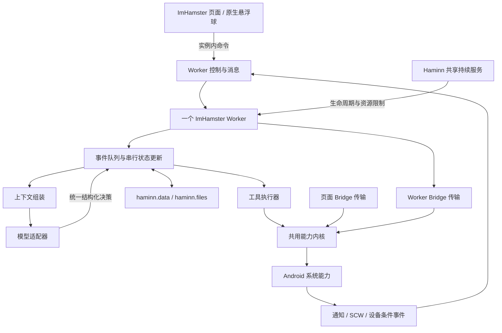

# ImHamster 1.1 开发计划

> 编制日期：2026-10-10。依据：[产品设计 1.1](../docs/PRODUCT_DESIGN_v1.1.md)及当前 ImHamster、HaminnApp 工作树。状态：分阶段实施中；文末记录已完成验证，未标记部分仍属计划。本文中的新增接口和默认参数均为拟议合同，只有列入实施记录并通过验证的部分才视为可用。

## 1. 开发目标与范围

交付一个能在 Android 手机上持续工作的通用智能体代理：用户用自然语言设定目标，ImHamster 按任务组装上下文、使用工具、操作应用并核实结果；页面关闭后仍能运行，暂停、取消、版本更新和中断恢复有确定边界。

微信的新消息回复、历史与朋友资料辅助回复、朋友圈互动、资讯采集、加好友并持续交流，是贯穿开发的验收场景。实现通用执行机制，再以目标、资料和 Skill 表达这些流程，不把微信专用状态机写入宿主或编排器。

本次开发范围对应产品设计的三个核心阶段：持续运行底座、完整代理闭环、日常持续接管。第一轮不建设多智能体团队、工作流 DSL、向量数据库、通用插件代码沙箱、自动编写并执行任意工具代码、热词引擎或完整 OCR 系统。语音沿用现有能力，按实际任务需要接入；这些扩展不阻塞核心版本。

计划保持以下不变量：

1. 每个 ImHamster 实例只有一个 Worker、一个调度器和一个业务状态写入主体；页面与悬浮球提交命令并展示状态。
2. 页面和 Worker 使用同一套宿主能力实现、实例授权和数据隔离；Worker 不获得 `host.*` 管理权限。
3. 同一 Task 只有一个执行轮次；同一账号与会话的任务串行；同一设备屏幕一次只有一个操作主体。
4. 外部动作先保存意图，再派发，再核实；`accepted` 不表示业务完成，未知结果不自动重放。
5. 用户偶尔操作手机不暂停助手；明确暂停、取消或授权撤销立即阻止后续相应派发。
6. 模型决定业务规划和恢复；程序维护真实记录、任务关系、资源边界与控制状态。
7. 所有任务共用一种决策、上下文和工具执行合同；不保留页面版、后台版两套智能体循环。

屏幕操作的基线是 Android 11 / API 30 及以上、亮屏、已解锁、无障碍可用且目标应用能进入。宿主当前最低支持 API 29，但其无障碍截图不能因此被当作 API 29 已可用；低版本保留明确的能力不可用状态。后台等待不要求持续亮屏；收到事件可以入队，条件不足时保存进展并等待。持续服务、CPU 运行和屏幕可操作分别报告，不能相互替代。

## 2. 代码基线与应复用的基础

### 2.1 当前事实

| 代码入口 | 已有能力 | 对开发顺序的影响 |
|---|---|---|
| [ImHamster app.js](../app.js) | 页面 IIFE；悬浮球指令入口、模型请求、截图决策、操作与复核、Canvas 观察原型；`operationRunning` 限制单次执行 | 提取可复用函数，迁移到 Worker；不能把整份 DOM 脚本直接放入后台 |
| [haminn.json](../haminn.json) | schema 2，页面入口，当前版本 `0.1.23 / 24` | 当前未声明 Worker；必须先修改宿主 manifest 合同 |
| [MainActivity](../../haminnapp/app/src/main/java/life/airen/haminn/MainActivity.kt) 的 `dispatchPublic`、`destroyRuntime`、生命周期方法 | 公开能力分派、授权请求、页面事件与资源清理集中于 Activity | 先提取共用分派内核及会话资源所有权，否则页面关闭会影响后台执行 |
| [RuntimeSession](../../haminnapp/app/src/main/java/life/airen/haminn/runtime/RuntimeSession.kt)、[BridgeController](../../haminnapp/app/src/main/java/life/airen/haminn/bridge/BridgeController.kt) | 实例、代码、数据代次、会话标识、协程作用域；WebView 主 frame、Origin 与文档 epoch 校验 | 复用实例会话概念；增加独立 Worker 传输，不绕过或伪造页面校验 |
| [PermissionBroker](../../haminnapp/app/src/main/java/life/airen/haminn/capability/PermissionBroker.kt)、[AppRegistry](../../haminnapp/app/src/main/java/life/airen/haminn/registry/AppRegistry.kt) | 逐实例 grant、系统权限观测、Activity 弹窗；当前 grant 按实例/能力/资源范围保存 | 分离检查与请求入口，保留有效授权，调用时读取当前状态 |
| [ScreenInteractionAccessibilityService](../../haminnapp/app/src/main/java/life/airen/haminn/capability/ScreenInteractionAccessibilityService.kt) | 截图、拟人操作、系统导航回执、原生悬浮球 | 复用实际操作；补屏幕独占、清晰文件截图和原生观察 |
| [RecordsStore](../../haminnapp/app/src/main/java/life/airen/haminn/data/RecordsStore.kt)、[FileStore](../../haminnapp/app/src/main/java/life/airen/haminn/data/FileStore.kt) | 记录 CAS、原子 batch、按 key 前缀分页；文件逻辑 ID、分块写入 | 足够实现首版，不另建 happ 数据库；需增加受控分块二进制读取 |
| [NativeHttpClient](../../haminnapp/app/src/main/java/life/airen/haminn/capability/NativeHttpClient.kt) | 原生 HTTP、重定向逐次授权、请求体文件、较大响应落文件、流与 socket | 复用网络策略；补普通请求的会话所有权、取消及传输大小一致性 |
| [PackageManifest](../../haminnapp/app/src/main/java/life/airen/haminn/install/PackageManifest.kt)、[InstallCoordinator](../../haminnapp/app/src/main/java/life/airen/haminn/install/InstallCoordinator.kt) | 严格 manifest 校验、不可变 release、release lease | Worker 入口从已安装代码解析，运行期间持有 release lease |
| [DevWorkspaceManager](../../haminnapp/app/src/main/java/life/airen/haminn/deploy/DevWorkspaceManager.kt) | 开发树 revision、内容寻址 blob、页面运行配置 | Worker 必须绑定固定开发 revision，不能边运行边读取变化中的文件树 |
| [能力清单](../../haminnapp/api/capabilities.json)、[协议](../../haminnapp/api/protocol-v1.md)、[SDK](../../haminnapp/sdk/haminn-api.d.ts) | 已有公开 API；`notifications` 负责通知发布与计划 | 另增通知读取合同；不要将现有发布接口误当作监听能力 |

当前没有 happ 后台 JS 引擎、共享 Worker 服务、原生 SCW 或其他应用通知监听。现有分享/备份前台服务不能直接充当代理运行底座；现有嵌入式页面引擎迁移计划也不是 Worker 方案。

本基线包含用户尚未提交的宿主代码，不只依据 Git HEAD。实施时保留这些改动，先核实变化后的实际合同。ImHamster 当前不是 Git 仓库；本计划不要求初始化仓库，也不进行跨目录合并提交。

### 2.2 不能直接沿用的原型行为

- `run-trace` 是限长诊断记录，不是 Goal、Task、草稿与操作检查点。
- 当前 Canvas 截图比较依赖页面；Worker 中使用原生图像比较，不复制 Canvas 环境。
- 当前截图默认最长边 800，超限降到 640，宿主内联截图有压缩大小限制；导航可用不等于聊天与文章文字可读。
- 当前决策依赖固定置信度阈值与指令逐字授权引用，且对部分动作统一停止。新合同保留对象、内容、坐标与目标范围校验，按持续 Goal 的授权范围执行；模型报出的数字不能代替核实证据。
- 当前 `withTimeout` 只能结束等待，不保证取消原生请求，也不保证旧结果不会继续产生动作。
- 当前网络 SDK 已有特殊请求超时处理，Native 超时上限为 180 秒；协议文字仍有统一 60 秒描述。实施时统一实际期限，不能照抄旧文档或无条件缩短模型请求。

## 3. 统一架构与代码职责



### 3.1 HaminnApp：一个内核，两种传输

增加 `CapabilityKernel`，承接需要共用的公开方法分派。`MainActivity` 继续持有页面和界面请求协调器，调用内核；`WorkerBridge` 同样调用内核。角色检查在内核入口统一落实。

`RuntimeSession` 增加运行种类 `PAGE / WORKER`、事件接收接口和资源 owner，保留原来的角色含义。会话身份至少包括实例 ID、sessionId、dataGeneration、代码 release 或开发 revision。页面的文档 epoch 仅用于页面传输；Worker 的 epoch 用于自己的启动、停止和代码切换。两者不可混用。

每个方法登记：可用运行种类、所需 capability/scope、是否需要前台 UI、资源 owner、超时和是否改变设备状态。可以用简单 Kotlin 分组 handler 与元数据表实现，不建设反射插件框架。方法详细 schema 和 SDK 仍由现有合同文件维护，避免另造业务 API。

**第一批提取**：`runtime.info/capabilities`、`app.info`、权限状态、`data.*`、无需系统文件选择器的 `files.*`、`network.request`、`interaction.*`、`overlay.*` 和设备可操作状态。后续按任务需要提取 TTS、语音及其他能力；暂不支持的 Worker 方法明确返回不可用，不静默转给不存在的 Activity。

Activity 相关方法经 `ForegroundRequestCoordinator` 调用有效界面入口，或返回需要前台处理的状态。弹窗、文件选择器、相机页面等仍由系统/界面组件负责。`host.*` 留在宿主管理角色边界内，不因抽取内核而开放给 Worker。

所有订阅回调发送给所属 session 的事件接收器，替换目前“当前页面 session 相等才发事件”的判断。页面销毁只释放页面 owner 的网络、语音、订阅和文件写入；Worker 停止只释放自己的资源。底层服务可共享，资源不能用 `cancelAll()` 相互误杀。

### 3.2 ImHamster：普通 JS 模块

建议直接使用随 release 打包的 ES Modules，无前端框架或转译要求：

```text
imhamster/
  index.html / app.js / style.css       页面配置、目标列表、状态与控制
  agent/
    worker.mjs                         唯一启动入口、宿主消息连接
    scheduler.mjs                      队列、状态更新、调度、控制与恢复
    context.mjs                        选择、检索、组装、压缩上下文
    provider.mjs                       HTTP、图片请求、响应解析、取消
    tools.mjs                          工具目录、决策校验与执行
    store.mjs                          记录 schema、CAS、batch 与索引
    skills/                            少量有证据的流程说明
```

先保持这六个职责模块。观察配置、人物资料、采集逻辑先放入对应模块；文件过大且职责真正独立时再拆分。共用纯函数可直接导出供测试使用，不引入 service locator、事件总线库或另一套持久化层。

页面保留当前配置和连接检查的入口，将执行按钮改为创建/修改 Goal 命令；诊断与运行状态从 Worker 获取。迁移完成后删除页面 `executeInstruction` 调度、`operationRunning` 执行锁和 Canvas 观察循环，悬浮球也只连接 Worker。

## 4. 先建设可运行的宿主合同

### 4.1 Manifest 与代码身份

在 schema 2 中新增一个可选字段，拟议格式：

```json
{ "background": { "entry": "agent/worker.mjs" } }
```

同时修改 `api/haminn.schema.json`、`PackageManifestReader`、安装校验、开发树运行配置、SDK/创作说明和对应测试。当前 parser 拒绝未知字段，只修改 happ manifest 会安装失败。

入口必须是规范化的包内相对路径，文件真实存在；模块导入也只能位于该代码树。入口信息以该 release 的 manifest 为唯一事实来源，不在多个数据库字段中维护重复副本。`workers.start` 不接受任意 JS、远程脚本 URL 或调用者自填实例 ID。

首版支持不可变本地 release 和固定 revision 的 DEV 树。DEV 使用现有内容寻址快照，取得快照时固定 revision 并持有其 blob 引用，模块解析持续使用同一快照；切换时整体停止旧 Worker、加载新 revision。若现有 blob 回收不支持引用，则补快照 lease，不让运行中的文件被回收。

新增 manifest 字段先随宿主合同交付，再更新 ImHamster 包；旧宿主会拒绝未知字段，不提供伪装可用的兼容入口。页面以能力发现展示实际支持条件。

线上来源与运行模式仍按现有正交定义处理。没有本地 release 的 LIVE 页面首版不能启动 Worker；存在 release 但页面正在 LIVE 模式时，也不混用远程前台和旧本地后台代码，返回清楚的运行条件要求。不要靠读取远程当前页面脚本规避代码身份。

### 4.2 嵌入式 JS 引擎

**选定技术路线：上游 QuickJS C 引擎 + 薄 JNI 绑定。** 先用最小工程验证，锁定通过验证的上游版本和摘要，随 APK 打包源码/库与许可。这里选择的是实现路线，Android 集成、ABI 和稳定性尚未验证。

每个 Worker 独立 `JSRuntime` 和线程，运行其模块、Promise jobs、受控 timers 与事件。Native 异步调用在 Kotlin 协程执行，完成后回到 Worker 线程 resolve/reject；不得从多个线程直接操作同一个 JS runtime。Job 队列分段执行，控制消息与中断标志有优先权，不能一次无限排空。

提供 `haminn` Worker SDK、JSON、Promise、必要的 UTF-8/二进制编码辅助、受控 timers 和限长日志。没有 `window/document/Canvas`、任意文件系统、进程执行或网络 `fetch`；模块 loader 不暴露 QuickJS 的 `std/os` 或动态原生模块。首版不依赖 `Intl`、浏览器 `URL` 或未实现 Web API；需要解析 provider URL 时采用明确实现的纯函数或宿主校验结果。

资源限制由 Native 强制执行：内存上限、栈上限、单段 JS 执行期限、待处理 jobs、timers、网络并发和消息大小。用 `JS_SetMemoryLimit`、`JS_SetMaxStackSize`、`JS_SetInterruptHandler` 及受控事件循环实现；超限清理该 Worker，不影响其他实例。[QuickJS 官方文档](https://bellard.org/quickjs/quickjs.html)说明了这些接口及其运行时线程约束。

初始调试值可以采用每实例 32 MiB JS heap、单段同步执行 100 ms、最多 16 个在途 RPC、全局最多 4 个 Worker；必须用图片请求峰值、Promise 压力和低端设备结果修订。Native bitmap 与网络缓冲不受 JS heap 限制，另设上限并及时回收。模型等待时间不计为同步 JS 执行时间。

首个技术门槛必须证明：模块导入、Promise 返回、timer、事件、中断无限循环、内存超限、Worker 单独停止、实例隔离以及设备 ABI 构建。失败先修复集成；不能用隐藏 WebView 替换这一底座后继续宣称方案完成。

### 4.3 服务、启停与消息

新增 `HappWorkerService`，由 `HaminnApplication` 的运行管理器统一创建和回收 Worker；Android 无障碍与通知监听仍是独立系统组件。不要复用已经承担其他职责的 `host.agent` 服务命名。

持续服务优先验证 `specialUse` 是否符合实际用途，声明 `FOREGROUND_SERVICE_SPECIAL_USE` 与真实 subtype 说明，并检查目标系统及分发要求。现有 `dataSync` 服务在现代 Android 有运行时限，不能承诺无限常驻。启动从用户正在使用的页面或满足系统条件的原生入口触发；不能在 `Application.onCreate` 或任意后台事件中无条件启动。[服务类型](https://developer.android.com/develop/background-work/services/fgs/service-types)、[后台启动限制](https://developer.android.com/develop/background-work/services/fgs/restrictions-bg-start)、[服务时限](https://developer.android.com/develop/background-work/services/fgs/timeout)。

后台运行使用拟议实例能力 `workers.run`，由用户首次开启持续运行时通过现有授权流程授予，之后持续有效直到撤销；不增加每 Task 授权。它只允许该实例运行自己的声明入口，截图、操作、网络和通知读取仍各自检查原有或新增的能力范围。

拟议公开命名空间 `workers`：

| 方法 | 最小含义 |
|---|---|
| `start` | 启动当前实例 manifest 声明的入口；同实例同代码身份幂等，返回 workerId/epoch/状态 |
| `stop` | 停止实例 Worker，立即关闭派发入口，取消 owned 资源并保存宿主停止状态 |
| `status` | 查询代码身份、运行状态、资源与能力条件，不包含业务内容全文 |
| `send` | 向实例 Worker 交付带 commandId 的有界命令，不等待模型完成 |
| `control` | 通用执行闸门：暂停/恢复新执行派发；暂停时仍允许控制消息、状态保存和事件入队 |
| `ack` | Worker 确认已经持久化接收的宿主事件 |

Worker 通过同一消息接口向本实例页面发状态摘要；页面重连先取快照，再接更新。状态包含递增 revision，漏更新就重新取快照，不重建另一套执行器。控制消息与业务事件分别排队，控制优先；普通命令幂等去重。

`start/stop/control/send` 是本实例页面与原生入口的控制能力，Worker 仅接收命令、发送状态和确认事件，不允许递归启动自己或启动其他实例。运行能力清单分别报告页面与 Worker 的支持范围；不要增加一个可以访问 `host.*` 的 Worker 角色。

`control` 是宿主的执行闸门，不理解 Goal 内容。用户暂停助手时先关闸，再提交业务暂停命令，Worker 保存全局状态；取消全部也先关闸，再取消 Goal/Task 并释放订阅。恢复时先让 Worker 读取持久状态、更新执行修订并准备恢复，再打开新派发。状态保存失败时保持关闸并展示错误。单 Goal 暂停由 Worker 更新其修订，不停止其他 Goal。

闸门通过方法元数据阻止新的执行请求和设备动作，仍允许控制、状态读取、持久化、事件确认与资源释放。已进入 Native 队列但尚未实际派发的动作再检查闸门；已经派发的动作只能取消系统确实支持取消的部分，回执仍送回。新 Worker 默认先关闸，读取持久启停状态后才能开始执行，避免服务恢复绕过用户暂停。

页面消失时，原生悬浮球将目标与控制命令直接交给 Worker，不能依赖页面 `overlay.on` 监听。持续通知提供宿主停止入口；JS 卡死时 Native 仍可关闭闸门、触发引擎中断并清理。暂停不等于卸载 Worker，等待期间仍能接收有界事件。

Native 的通用注册与事件缓冲放在现有宿主 Registry 的小型表中，按实例、dataGeneration 和 Worker epoch 隔离，不建立第二套业务数据库。事件先存再交付，Worker 写入自己的 inbox 后 ack；未 ack 允许重送。停止/取消对应订阅后不能被旧订阅重新启动。队列溢出生成遗漏标记，图片文件使用引用与期限而非内联。

普通进程退出后，只有在系统允许的启动入口重新进入时才恢复启用的 Worker；运行登记不等于启动许可。用户明确停止服务/强制停止后的状态不得被自启覆盖。活跃轮次短时使用有期限的 wake lock，等待释放；锁屏期间不自动点击或绕过解锁。

### 4.4 授权与会话清理

将 `PermissionBroker` 分为：Application 可用的当前权限检查，以及需要有效 UI 的请求协调器。已有授权直接使用；缺失时返回既有权限错误并附所需入口，ImHamster 保存等待原因，用户进入有效设置入口后继续。后台不循环弹窗。

每次能力派发检查当前实例存在、当前数据代次、代码/session 有效性、最新 happ grant 和系统能力状态。不要只检查启动时的 `WebAppInstance` 快照。保持现有按实例/能力/scope 的授权语义；普通更新、Task 新建和恢复不制造授权期限。

grant 撤销通知到运行管理器，立即关闭相关订阅与后续派发；事件交付前也查当前 scope，不能让已经注册的通知监听继续泄露新内容。撤销 `workers.run` 直接停止该 Worker。现有已采集资料的保留/删除由用户资料管理决定，不把撤权偷偷解释成清空全部数据。

会话关闭顺序：关闭新派发 → 标记 epoch 无效 → 取消 native 请求/订阅/文件写入 → 释放屏幕 lease 与观察 → 终止引擎 → 释放代码 lease。回调仍可到达，必须因 epoch 失效被隔离。数据清空、实例移除、备份恢复导致 dataGeneration 改变时同步停掉旧会话，旧任务不能写入新代次。

代码更新与 DEV revision 切换也走这一关闭顺序：能正常响应时先让 Worker 保存检查点，再停止旧会话；超时则强制停止并保留最后已提交事实。新版本检查业务 schemaVersion、执行必要的幂等数据迁移后恢复，迁移失败保持关闸。不得同时运行两版 Worker，也不得为了继续任务把用户数据复制进 release。

## 5. 设备操作与模型请求的完整通道

### 5.1 屏幕独占与可操作状态

新增拟议 `interaction.acquire/release/leaseStatus`。Native 维护一个设备级 lease，绑定 session、epoch 和 leaseId；Worker 在其上维护一个 `screenOwnerTaskId`。这不是多级业务锁：Native 防实例间竞争，ImHamster 决定自己的哪项工作占屏。

所有改变页面、焦点或输入的工具，包括系统导航、通知入口打开和将来应用入口，都经过 lease。宿主其他消费者在已有 lease 时也必须获得明确冲突，不允许绕过；没有 lease 时，现有消费者的调用仍由同一个原生操作队列序列化。操作前在 Native 再查 lease 与执行闸门，排队期间失效的动作不派发。

一个占屏轮次覆盖“截图 → 模型判断 → 动作 → 结果截图与核实”。短连续输入/发送可保持占用；长等待和已保存的浏览边界释放。原生 lease 有会话清理和有限续租机制，续租由运行管理器维护，不依赖 JS 在等待网络期间频繁发心跳。

扩充 `interaction.status` 返回亮屏、锁屏、无障碍连接与截图可用状态。保持亮屏配置仅在系统支持且用户选用时实施；首版先验收用户已保持可操作的环境，不把持续操作建立在绕过锁屏上。

用户改变画面不撤销 Goal。动作派发前复核截图时效、屏幕修订、对象与相关区域是否明显变化；失效则重新判断。像素比较不能保证瞬时竞争完全消失，发送仍要核实对象、内容和结果。重新取得 lease 后必须重新截图，不能沿用旧坐标。

### 5.2 清晰截图到模型

保持同一个 `interaction.capture` 实现，增加可选 `output:"file"`、清晰度和区域参数，返回 logicalFileId、mime、字节数、原屏尺寸、输出尺寸、区域原点/范围、采样时间和场景修订。保留已有消费者需要的内联模式，ImHamster 主执行链切到文件模式，不维护旧版执行器。

补 `files.readBytes({logicalFileId, offset, maxBytes})`，按实例与数据代次校验，返回 chunkBase64、nextOffset、eof 和 metadata，单次原始字节最多 64 KiB。该方法不暴露文件路径，也不能读取其他实例文件。现有 `files.readText` 不是图片读取接口。

首版模型图片通道如下：

1. 获取截图文件，导航用整屏适度清晰度，密集文字和草稿用清晰整屏或区域。
2. Worker 分块读取，构造 provider 支持的图片 data URI。分块采用 48 KiB 等 3 字节对齐长度，最后一块才允许 Base64 padding；禁止直接拼接任意带 padding 的 Base64 块。
3. 请求 JSON 超过传输安全范围时，用现有 `beginWrite/appendBytes/finishWrite` 写临时 JSON 文件，再调用 `network.request({bodyLogicalFileId, contentType:"application/json"})`。
4. 响应既支持 bodyText，也支持 logicalFileId；解析前检查大小、MIME、JSON 结构与真实 assistant 输出。
5. 结果提交或请求结束后删除无引用的临时请求文件。证据截图按任务/资料引用保留，不一并清理。

模型服务器不能读取本机 `apps.haminn.invalid` 或文件对象 URL，因此不能仅把截图 file URL 放进模型消息。首版无需为模型协议新建宿主专用 API，使用通用文件和网络能力完成。

原生截图初始限制可采用每张编码图片 2 MiB、每次模型请求最多两张图片，并用真实文字阅读验证；发现文字不可辨认时调整取样，不能重新压到模糊后写确定事实。坐标在图片/区域空间中表达，工具执行器按返回的实际尺寸与偏移映射回整屏。

### 5.3 网络、期限与旧结果

普通 `network.request` 补 session owner 与 requestId，追踪 OkHttp Call。协程取消、Worker 停止和超过实际 deadline 时调用 `Call.cancel()`，覆盖等待响应头与读取响应体的阶段；重定向仍逐次检查目标 origin 与地址范围。

页面传输、Worker 传输与 Native 共用方法期限策略。请求超时按显式 timeoutMs 和 Native 上限确定，传输等待留有限交付余量；不继承 ImHamster 的固定 35/55 秒上限。普通响应即使 Native 判为“小于 1 MiB 的内联”，也可能超过 Bridge 256 KiB 上限，因此共用结果适配层在超过安全阈值时落文件，两种传输保持相同返回语义。

Provider 首版保留当前最小 Chat Completions 请求体 `{model,messages}`，从 assistant 内容解析结构化 JSON 决策。工具 schema 放入相关上下文，不默认要求 provider 支持原生 `tools`、stream、reasoning 参数或 JSON mode。以后确实验证过的 provider 特性放入同一适配器，不能改写调度合同。

复用当前 `screen-interaction/provider` 已保存配置，经 Worker 迁移到新的版本化配置记录；不读取或复制本机私有配置到计划、日志或发布包。开发脚本配置仅作为已有安装的迁移入口，正式配置由页面提交 Worker 保存。API key 与原始模型消息不进入普通诊断轨迹。

## 6. 业务数据、决策与执行一致性

### 6.1 使用现有存储

`RecordsStore` 单记录最多 64 KiB、batch 最多 100 个不同 key、scan 每页最多 100 条且只有 key 前缀能力；总量上限现为 128 MiB/100000 条。每个实体一条或少量分块记录，不存整份 agent 巨型快照。长文章、图片、请求体放 `files`，记录保存引用。

首版集合建议：

| 集合 | 主要记录及必要字段 |
|---|---|
| `agent-config` | schemaVersion、全局启停/修订、provider、persona、预算与采集设置 |
| `goals` | goalId、原始意图、范围、触发、一次性/持续、状态、revision、接管边界、摘要 |
| `tasks` | taskId、goalId、runId、revision、依赖、objectKey、状态/等待原因、步骤、上下文策略、结果引用 |
| `inbox` | eventId、来源、发生/接收时间、对象线索、合并范围、处理状态、证据引用、遗漏标记 |
| `operations` | operationId、task/run/revision、工具、目标/草稿引用、意图、准备时间、回执、核实层级与证据 |
| `objects` | 账号/应用/会话/内容的本地身份、别名与身份依据、当前 revision、处理边界、跨 Goal effect 记录 |
| `materials` | 来源、对象、采集范围/位置、时间、顺序、正文/图片引用、覆盖完整度与资料 revision |
| `knowledge` | 关系事实、推测、经验、Skill；类型、对象/标签、来源、修订与有效状态 |
| `indexes` | 对象/时间/标签/关键词到记录 ID 的有界分页索引，不复制正文 |

这是集合划分，不是新增九套服务。每条记录使用现有 CAS revision；业务 revision 用于异步结果校验，二者不能混淆。大索引按页分块；检索先按对象、时间、类型缩小候选，再本地排序筛选，不假定 `data.scan` 支持全文搜索或任意 SQL。

`objects` 中身份、处理游标与每个 effect 分开存 key，消息/条目标识也采用有界分段，不在一个联系人记录里无限追加全部历史。终结 Task、旧 inbox 和诊断按保留策略归档清理；未决 effect 和仍需去重的处理边界保留。清理按分页分批执行，不每次启动全量加载记录。

所有业务写入经 Worker 的串行状态循环。页面编辑、删除人物资料也提交命令，使用 CAS 并失效相关缓存。Worker 未启动时页面先请求启动；不绕过它直接写运行中记录。宿主只管理运行登记、原生回执和通用事件，不理解上述业务 schema。

文件与记录没有跨存储事务：先完成文件写入，再 batch 保存引用；失败后文件进入孤儿清理。正在引用的材料、未决操作证据和待发送草稿不能被普通日志清理回收。删除资料同时更新索引与修订，旧上下文不能继续使用已删除内容。

### 6.2 统一模型决策

所有 Task 共用一个结构化输出，核心字段如下；详细 schema 在实现时固化并直接用于校验：

```text
kind: act | manageTasks | wait | complete | ask | fail
progress: 当前已知进展摘要
evidenceRefs: 支持本次判断的资料或当前截图标识
act: { tool, args, objectKey, intent, effectKey?, expectedResult }
manageTasks: { add[], update[], cancel[] }
wait: { reason, until?, eventFilter?, dependencyIds? }
complete: { resultSummary, verifiedLevel, resultRefs[] }
contextRequest?: { materialRefs?, objects?, tools?, needPersona? }
knowledgeChanges?: 有来源的候选更新
```

一轮最多派发一个外部动作；可原子提交一组任务管理或资料更新。模型想读取额外历史/工具详情，通过普通工具轮次补齐，再判断，不一次给出不可中途核实的长坐标脚本。

校验覆盖：类型/schema、真实可用工具、参数边界、目标范围、对象身份、当前证据、运行状态、预算、依赖无环和效果重复。`complete` 必须引用与完成标准相符的证据。错误 JSON 可以在预算内修复一次，仍失败则记录原因，不能从自然语言中猜测执行点击。

Goal 的语义范围由模型结合用户原意判断，程序检查结构化限制与变更版本。已经授权的自动回复不用要求用户给出逐字正文；指定精确正文时则必须核对。来源内容作为引用资料进入上下文，不得变成系统指令、扩展 Goal 或修改授权。

### 6.3 关键动作保存与核实

对发送、发布、提交申请、点赞等改变外部状态的动作，统一执行：

1. 检查 assistant/Goal/Task 修订、对象 revision、execution gate、屏幕 lease、预算和证据。
2. 用一个 `data.batch` 保存操作 `prepared`、Task 待决状态、object effect 保留项；CAS 失败先重读，不派发。
3. 再检查控制状态，携带 operationId 与 lease 派发。Native 查 epoch/权限/lease/闸门，返回已知回执。
4. 保存 `accepted / failed / unknown`。取得结果证据后，模型判断达到的结果层级，更新为 `verified` 或继续核实。
5. 原子更新 Task 进展、对象处理边界与 effect 结果，再让出屏幕。

宿主将现有系统导航回执机制扩展为通用交互 operation receipt，拟议 `interaction.operationStatus`；保留现有消费者的 `globalActionStatus`，同用一个回执存储，不另造平行日志。相同 operationId 的重送查询已有状态，不盲目再次派发；记录带实例、数据代次、session 与参数摘要，冲突内容拒绝。

原生回执只记录 `scheduled / accepted / rejected / failed / unknown` 等事实，业务 `verified` 由 ImHamster 记录。进程死亡可能发生在动作之后、回执保存之前，这个窗口无法靠事务消除；该记录必须保持未知，交给模型看当前应用核实，不能改成“肯定未执行”。

跨 Goal 的 effectKey 由账号、已确认对象、动作意图和内容锚点组成。文本哈希只辅助比较；同样文字的不同消息、不同联系人不能合并。点赞是状态切换，恢复前先确认已有状态；发送结果出现在会话不等于对方已读，申请提交不等于好友接受。

effectKey 由程序依据已确认字段规范化生成，模型提供对象/内容依据，不直接信任任意模型字符串作为去重身份。同对象的不同 Goal 指令一致时复用已知结果；要求不同回复或出现冲突时先交协调 Task 判断，不让第二 Goal 直接绕过去重记录再次发送。

### 6.4 异步修订与中断恢复

每次异步作业捕获 `workerEpoch + assistantRevision + goalRevision + taskId/runId/taskRevision + objectRevision`。结果先作为事件进入状态循环，再判断是否仍有效。失效结果不执行后续动作；如果是已派发动作的回执，仍更新原操作的事实记录，不能因取消而丢掉实际结果。

恢复沿用中断 Task 的 runId，增加执行 revision；用户主动重跑才生成新 runId。启动时读取未终结 Task 与操作，将残留 `running` 改为需要恢复的 `ready/waiting`，释放失效资源，查询已知回执。涉及屏幕时重新取得 lease 和截图，再把真实进展与未决事项交给模型。不要按业务类型硬编码恢复路线。

读网络与截图的暂时失败可有限退避；结果未知的外部动作不能透明重试。关键持久化失败进入等待，保留执行闸门/受影响任务限制，不能继续无法追踪的发送。

## 7. 调度、上下文和持续观察

### 7.1 单队列与有界执行

调度器采用事件队列、串行 reducer 和异步 jobs。reducer 中不等待模型或长工具调用：先保存当前状态，启动 job，结果再入队。每个 Task 只能有一个 job；首版最多两个模型请求，但必须服从同对象串行与屏幕独占。

Task 状态严格沿用产品设计：`ready/running/waiting/paused/done/failed/cancelled`。等待记录时间、事件、依赖、用户补充或设备条件；未满足时不反复请求模型。失败要有明确原因，不把短暂能力断开一律终结为 failed。

调度顺序：控制命令 → 在途效果核实 → 符合条件的 ready 任务。ready 按用户优先级与等待时间选取，长期等待有老化机会。等待资源期间不占模型槽；占屏的模型判断保留 screenOwner，其他纯资料任务仍能使用空闲槽。

浏览/采集在保存位置与资料后让出屏幕。建议初始最多连续三个普通轮次或 60 秒后在下个安全边界让出；不能在已派发发送、尚未核实效果的中途抢占。若模型超时使轮次超预算，先结束该等待、记录并检查是否有未决效果，再释放资源，不无限占屏。

Goal 的理解与拆分是一个普通协调 Task，使用同一合同和模型适配器。每个 Goal 最多一个活跃协调 Task；子任务完成/关键变化合并后唤醒它。依赖用任务 ID，校验存在与无环；一个 Task 的 done 不直接代表整个 Goal 完成。

为每次处理设置步数/调用预算、每 Goal 触发速率与同时待办上限。持续 Goal 仍长期有效，限流后按策略等待下一周期。日常界面展示积压、阻碍与进度，不能通过增加模型并发掩盖单屏吞吐瓶颈。

### 7.2 上下文引擎

按当前 Task 组装：基本执行规则 → Goal 原意与结构化范围 → Task 进展/待决操作 → 当前证据 → 相关资料与关系事实 → 必要经验/Skill → 选定工具详情 → 按需 persona。上下文保存用到的记录 revision 和引用列表，发送前检查影响判断的变更。

机械导航、点击和整理格式通常不加载 persona 与全部历史；回复、关系交流等才加载相关人格、记忆和对象资料。角色可以影响表达，不能覆盖用户目标、工具合同和当前事实。

提供简单 context policy：`mechanical / read / communicate / coordinate`，只决定默认选择与预算，不形成四套执行器。模型可以请求额外资料，调度器按普通读取工具补齐。

首版按字符/估算 token 设软预算，按 provider 明确能力设请求硬上限；没有 tokenizer 时明确是估算。预算不足先保留用户原意、未决动作和近期事实，再摘要历史、裁剪可回查资料。不得压缩掉接管边界、发言者、顺序、身份歧义和待发送正文。

采集聊天/文章时分段保存材料，至少包含来源应用/账号、对象、可见发言者、原始时间文本、顺序、本地条目标识、图片引用与覆盖范围；无法看见真实时间时保存未知，不补造时间。滚动续读保存末尾锚点、可见重叠与未覆盖部分，不能仅保存最后一句总结。

资料先按对象和来源归档，知识是其有来源的提炼。人物事实与推测分开，冲突保留来源和有效时间，身份不确定时不把同名联系人混为一人。经验注明适用场景、成功证据和最近使用结果；失效 Skill 可停用，不自动把单次失败永久固化。

首版 Skill 是说明性流程和参数化工具组合建议，由同一 Task 逐步执行，不能包含直接执行的模型生成 JS。真实可调用工具是代码注册表；先给摘要目录，只有选中才加载 schema 与使用说明。

### 7.3 通知、时间与 SCW

**通知读取**：新增独立 capability `notifications.read` 及拟议 `notifications.listen/unlisten/snapshot/open`，使用 NotificationListenerService。订阅只能访问已授权范围内的来源包，报告系统实际提供的标题、文本、时间、notification key 和可用入口；不读取不存在的聊天数据库。`open` 经过屏幕 lease，失效入口回到画面导航。首版不依赖通知直接回复来完成发送闭环。

系统 notification key 是通知更新身份，不是业务消息唯一身份。后台监听先做结构性过滤、合并与有界持久化，不调用模型。Listener 连接后查询的是当前 active notifications，不是完整历史；断线/进程退出期间的缺失用遗漏标记与 Goal 巡检补足。[Android NotificationListenerService](https://developer.android.com/reference/android/service/notification/NotificationListenerService)。

**SCW**：在原生共享截图采样器上增加 `interaction.watch/watchStatus/unwatch`，支持 1–8 个归一化区域、any/all、阈值、采样间隔、连续命中与冷却。各观察复用符合时效的同一帧，限制总采样频率；Android 截图间隔过短会失败，应返回可重试状态。[无障碍截图间隔错误](https://developer.android.com/reference/android/accessibilityservice/AccessibilityService#ERROR_TAKE_SCREENSHOT_INTERVAL_TIME_SHORT)。

固定有效基线直到模型复核或场景重建，不能每个未命中样本都覆盖。比较在 Native 完成，低分辨率样本只判断变化；触发保存原场景的有期限画面文件、采样时间、sceneRevision。过期则标记证据失效，不能换成别的页面截图充当原触发证据。

宿主只清理观察资源拥有的临时画面。需要长期保留的触发证据，Worker 在期限内通过现有文件分块通道保存为普通实例文件，再提交资料/操作引用；事件 ack 不等于长期证据已经保存。过期或保存失败保留相应事实，不写悬空的永久证据引用。

采样前隐藏 Haminn 管理的悬浮层，在成功、失败、取消的 finally 中按当前 overlay registry 恢复；已经删除或更改的 overlay 不得复活。共享 sampler 内串行处理这一过程，避免重叠 hide/restore。

watch 定义归 Goal 保存，Native watchId 是临时资源。Task 切换页面时暂挂旧场景观察，重新进入并取得基线后恢复；用户操作引起变化由模型确认当前场景。SCW 只能观察当前屏幕，多应用接管依靠通知与巡检。

**事件与巡检**：通知、SCW 和 timer 共用 inbox。先写入再 ack，再匹配启用 Goal；没有匹配目标不启动业务。短消息合并窗口有上限，例如初始 2 秒、最多等 5 秒；同对象已有 Task 时更新其对象 revision，使旧回复在发送前重判。

接管起点保存为明确策略：处理当前积压或只处理接管后新内容。通知只是定位线索，Task 进入会话后核实发言者、已处理边界与当前内容。群聊按 Goal 的触发条件筛选，自己发出的消息用于结果核实，不自动触发回复自己。

timer 在活跃 Worker 内实现，重要截止时间持久化；服务恢复时按 Goal 的补做一次、合并或跳过策略生成事件。无需对每个采样点设置系统闹钟。即使通知正常，仍保留低频、限定范围的巡检任务；巡检按内容与处理边界判断，不只看未读角标。

初始宿主事件缓冲可限制每实例 200 条/1 MiB，ImHamster inbox 另设总上限并按对象合并。SCW 画面期限可从 60 秒起验证；无法及时处理时保留丢失/过期事实，补采当前信息，不制造无限积压。

## 8. 分阶段实施与验收门槛

以下按依赖执行，不把一阶段的失败留给后续阶段掩盖。每阶段先打通一条端到端链路再扩展；第一至第二阶段对应产品设计阶段 1，第三至第四阶段对应阶段 2，第五阶段对应阶段 3。

### 阶段 0：冻结关键合同与技术验证

| 编号 | 工作项 | 产出/通过条件 |
|---|---|---|
| P0.1 | 核实工作树、目标设备 Android/ABI、无障碍截图、模型图片输入和当前请求/返回格式 | 记录真实支持条件；不把 text 请求成功当图片请求成功 |
| P0.2 | 更新宿主“允许受控 happ Worker”的产品边界与 AGENTS 表述，制定 manifest、Worker、session/owner、错误状态合同 | 一个合同草案，所有模块使用同一命名与身份语义 |
| P0.3 | 最小 QuickJS/JNI 集成与 FGS 启动验证 | 模块/Promise/事件/中断/内存限制和服务停止入口在目标设备成立 |
| P0.4 | 以拟议文件截图/readBytes 的最小实现和现有文件请求能力构建清晰图片探针 | 一次实际会话文字可辨认且模型返回真实文本；记录内存、大小与期限 |

P0 不写完整记忆、通知监听或大量页面功能。若设备截图不可用、引擎无法受控或图片 provider 不支持，应明确解决这一阻碍后再扩大实施。技术探针仅用于验证，阶段 1 将其并入正式通道，不留下永久旁路。

### 阶段 1：宿主持续运行与共享能力底座

| 编号 | 工作项 | 主要落点 |
|---|---|---|
| P1.1 | 提取能力内核，分离当前权限检查/前台请求、会话事件和资源清理 | MainActivity、RuntimeSession、PermissionBroker、新 CapabilityKernel/ForegroundRequestCoordinator |
| P1.2 | Worker manifest、release/DEV snapshot lease、生命周期与注册 | PackageManifest、InstallCoordinator、DevWorkspaceManager、新 worker 运行包 |
| P1.3 | WorkerService、QuickJS 运行管理、SDK、IPC、执行闸门与独立停止 | Application、Manifest、Gradle/NDK、WorkerBridge、原生悬浮球路由 |
| P1.4 | 屏幕独占、设备状态、文件截图、readBytes、通用操作回执 | ScreenInteractionAccessibilityService、FileStore、内核 handler |
| P1.5 | 网络 owner/取消、大小与期限统一、文件请求探针转正式链路 | NativeHttpClient、页面 SDK、Worker SDK、协议 |
| P1.6 | 同步公开合同、示例与合同检查器 | api、sdk、创作说明、tools/validate-contracts.mjs、contracts.test.mjs |

**验收**：一个普通 happ Worker 可以在页面销毁后继续收事件、访问自己数据、调用已授权截图与网络；重开页面不产生第二 Worker。两个实例不能串数据或同时操作屏幕。撤销授权、数据清空、停止、代码切换后旧回调不继续调用能力。卡死 Worker 可独立停止。此阶段用最小夹具验收运行底座，不宣称完整 ImHamster 已完成。

### 阶段 2：ImHamster 单目标完整执行与恢复

| 编号 | 工作项 | 产出 |
|---|---|---|
| P2.1 | 六个 JS 模块、业务记录 schema、单写入命令处理、现有 provider 配置迁移 | 一个可启动 Worker，页面只做配置与控制 |
| P2.2 | Task 统一决策、上下文基础、工具注册与校验、清晰图片模型通道 | 语义指令到动作/核实的唯一循环 |
| P2.3 | prepared/batch、回执、effect 保留与核实、异步修订栅栏 | 任意阶段中断都有真实可查记录 |
| P2.4 | 暂停/恢复/取消、设备条件等待、模型主导恢复、状态 UI | 页面与悬浮球独立可控，失败不丢进展 |
| P2.5 | 删除旧页面执行与 Canvas 路径，保留必要迁移读取 | 不存在两个可能同时运行的执行入口 |

**验收**：真实微信会话中执行用户给定的一次回复任务，读取相关文字、输入、核实对象/草稿、发送并检查会话结果；期间离开 ImHamster 页面仍能完成。分别在模型等待、动作准备后和发送后人为中断，恢复由模型依据记录与画面继续，不重复发送。暂停时新派发立即关闭，已派发动作仍如实记录。用户偶尔切换页面后任务可恢复。

只有这条闭环完成，才建设多目标与资料库，避免在不可用底座上扩张。

### 阶段 3：Goal 协调、多任务与公平调度

| 编号 | 工作项 | 产出 |
|---|---|---|
| P3.1 | 一次性/持续 Goal、协调 Task、依赖管理、预算与结果复核 | 复杂目标可分解，同一 Task 合同执行 |
| P3.2 | 两个模型槽、同对象串行、屏幕安全边界让出与公平性 | 资讯阅读与消息任务可交错推进 |
| P3.3 | 对象身份、对象 revision、跨 Goal effect 共用与冲突交给模型 | 同一消息/条目不因多个 Goal 各执行一次 |
| P3.4 | 长等待、时间唤醒、局部控制与目标修改 | 好友申请等待跨天，不长期占屏 |

**验收**：手工或 timer 注入消息 Task 与长文章采集 Task，浏览保存位置后让屏，消息处理后续读；纯资料整理可在另一个 Task 占屏时推进。循环依赖拒绝，协调器不会重复拆分，单任务 done 不错误结束综合 Goal。Goal 修改后的旧草稿不发送，暂停一个 Goal 不误停其他 Goal。

### 阶段 4：上下文、资料与经验闭环

| 编号 | 工作项 | 产出 |
|---|---|---|
| P4.1 | context policy、引用/revision、对象检索、预算和可回查压缩 | 机械任务省略无关人格与历史，交流任务加载相关内容 |
| P4.2 | 分段资料、覆盖范围、滚动锚点、索引、图片/长文文件引用 | 中断续读与来源可查，不将部分读取当全文 |
| P4.3 | persona、关系事实/推测、经验与 Skill 生命周期 | 根据真实积累回复，资料冲突/删除可生效 |
| P4.4 | 少量微信场景 Skill：会话定位/阅读、朋友圈、订阅号、好友申请 | 场景说明复用通用工具，不新增专用编排器 |

**验收**：首次资料不足时不捏造朋友信息；采集后能在下一任务检索来源并改善回复。两个同名联系人不合并，群聊发言者可区分。用户删除一条资料后在途上下文失效。文章部分采集有明确范围，重新进入继续采集而不重复归档。朋友圈互动核实已点赞/已留言，恢复不盲目切换点赞状态。

### 阶段 5：持续发现、接管与核心版本验收

| 编号 | 工作项 | 产出 |
|---|---|---|
| P5.1 | NotificationListener、逐实例 read grant、来源过滤、快照与入口 | 其他应用消息发现，发布接口保持原职责 |
| P5.2 | 原生 SCW、共享采样、基线/scene 管理、图像 TTL、overlay 恢复 | 无页面 Canvas 的可控观察 |
| P5.3 | 宿主事件 ack/重送/遗漏、Im inbox 合并、接管边界与低频巡检 | 有通知与无通知均有发现路径 |
| P5.4 | 连续消息重判、自发消息过滤、群聊条件、积压与限流显示 | 持续运行行为与吞吐可解释 |
| P5.5 | 综合场景和生命周期验收，清理探针/旧临时入口、同步说明 | 形成产品设计 1.1 核心能力交付 |

**验收**：持续处理指定会话、每日资讯整理和朋友圈互动共存；好友申请等待接受后继续目的性交流。连续新消息能使未发送草稿重判，自己消息不触发自回；禁用/清除通知时可经范围巡检发现待办。SCW 场景变化、基线缓慢变化、截图失败和事件过期均不产生错误业务事实。暂停/取消后，重送事件与旧回调都不能重启被停止目标。

语音任务可以在这一阶段接入已提取且确实可后台使用的能力，沿用事件/任务合同；热词和运动专用事件留待实证需求，不扩成核心版本前置条件。

## 9. 验证方法与交付判定

### 9.1 定向自动验证

不为静态页面文案或简单可逆调整堆叠测试；必须验证决定可靠性的状态与合同：

| 层 | 必测行为 |
|---|---|
| Native 会话/运行时 | 两实例隔离、模块越界拒绝、无限循环可停、内存限额、Promise 回调线程、epoch 失效、owner 清理 |
| 原生能力 | grant 撤销、数据代次变更、lease 冲突、排队动作暂停、取消 HTTP 读写、截图区域映射、操作 ID 重送 |
| JS 调度 | 同 Task/对象不并发、依赖无环、屏幕让出、控制优先、迟到结果隔离、Task 与 Goal 完成区分 |
| 保存/恢复 | batch 失败不派发、文件孤儿清理、prepared/accepted/unknown 恢复、取消后仍保存已发生动作结果 |
| 资料/上下文 | 分页索引、资料删除失效、同名身份、来源与覆盖、角色按需加载、预算裁剪保留未决事实 |
| 观察 | 重送去重、合并 revision、遗漏标记、固定基线、scene 切换、图片过期、overlay 不复活 |

纯 JS 模块以宿主接口 fake 和可控时钟运行 `node --test`，不引入完整浏览器测试框架。Native 纯状态逻辑用 Kotlin 单测，截图、手势、通知和 FGS 用实际设备验证；文本匹配测试不能代替这些行为。

宿主现有 `validate-contracts.mjs` 和部分 `contracts.test.mjs` 假定所有公开分派都在 MainActivity。提取后先调整其输入为实际共用 handler 与方法登记，仍检查 SDK/Native/Bridge 一致性，不用复制 dead code 来满足旧正则。

典型命令按变更阶段选用，在 `haminnapp/` 执行：

```sh
node tools/validate-contracts.mjs
node --test tools/contracts.test.mjs
./gradlew :app:compileDebugKotlin
```

JNI/CMake 引入后补受影响 ABI 的 native 构建与对应运行时测试；Kotlin 只跑新增/改动功能的定向测试。SDK 变更按现有 `sync-agent-assets.mjs` 同步实际派生文件。设备更新沿用仓库更新流程，代码稳定后构建一次必要 APK，不因每个小检查重复打包。

### 9.2 真实设备场景

| 场景 | 成功证据 |
|---|---|
| 页面关闭与重开 | 同一 Worker 身份继续执行；页面重连显示已保存进展 |
| 发送前后中断 | 可查操作与草稿，恢复检查实际会话，无未经判断的重复发送 |
| 新消息/连续消息/群聊 | 正确会话与发言者、处理边界、新内容导致草稿重判、自己消息不自回 |
| 朋友圈互动 | 对象和条目依据、互动前后状态、跨目标和恢复不重复操作 |
| 文章与朋友圈采集 | 正文可辨认、来源/顺序/覆盖、让屏后能续读与去重 |
| 朋友资料辅助回复 | 使用正确对象的可追溯资料；推测有标记；删除和冲突生效 |
| 好友与持续交流 | 申请提交、接受、会话出现分别核实；等待释放屏幕；交流目标持续推进 |
| 通知缺失与组件断开 | 缺失有说明、巡检可补当前待办，不能声称还原全部历史 |
| 暂停/取消/服务停止/撤权 | 后续派发被阻止，旧结果不重启，已发生动作仍有事实记录 |
| 用户临时操作与锁屏 | 临时操作后重新判断，锁屏等待，恢复后不沿用旧坐标 |

每条场景保留目标、设备/系统/应用版本、代码身份、事件及操作 ID、结果层级和必要证据引用；不在普通日志保存 API key 或全部私人消息。测试资料和账号范围由具体执行任务确定，本计划不执行设备操作。

记录通知/巡检发现延迟、任务首轮等待、模型耗时、占屏时长、处理总时长、调用量、积压、重复/误处理及资源峰值。首版不预定“秒回”或任意会话数量承诺；先用目标设备数据校准观察间隔、调用预算与屏幕轮换，确认可承载的工作量。

### 9.3 完成定义

核心版本完成需要阶段 1–5 全部通过相应门槛，且微信贯穿场景在指定环境取得真实证据。只完成 Worker、页面原型或模型连接检查均不能标为“日常接管已实现”。

交付时同步产品文档的实际实现状态、公开 Bridge/manifest 合同、SDK、运行条件、恢复与控制说明，区分“已支持”“受条件限制”“尚未实现”。安装/发布/版本与 Git 操作按当时仓库规则及用户交付要求执行，不由本计划自动触发。

## 10. 风险收敛与实施顺序

| 关键不确定项 | 最早处理点 | 明确处置 |
|---|---|---|
| QuickJS Android 集成与实际内存峰值 | P0.3/P0.4 | 先最小验证再扩业务；限制图片与缓冲，修复集成问题，不留下双运行时旁路 |
| FGS 类型、后台启动及设备厂商限制 | P0.3 | 验证真实启动条件，必要时等待用户主动进入；不承诺永不退出 |
| 页面资源与 Worker 资源互相清理 | P1.1 | owner 全链路绑定、分别清理与生命周期验收，禁止全局 cancelAll 误杀 |
| 清晰图片无法完整送到 provider | P0.4/P1.4–P1.5 | 文件读写/请求大小/响应形式一起验证，不只实现 capture 文件输出 |
| 界面变化或身份依据不足 | P2/P4 | 新截图和来源判断，保留歧义，由模型决定补读/导航/等待 |
| 动作已发生但记录未知 | P2.3 | 不做 exactly-once 承诺，保存未决操作、核实实际状态后继续 |
| 多目标争同对象、单屏积压 | P3/P5 | 对象串行与 effect 共享，安全边界轮换，展示积压并按实际吞吐限流 |
| 通知/截图只能覆盖部分信息 | P5 | 结合限定巡检与材料覆盖记录，明确遗漏与不可读范围 |

关键路径是：**受控 Worker 与服务成立 → 共用能力及清晰模型通道成立 → 单任务操作/核实/恢复成立 → Goal 与上下文成立 → 持续观察与综合接管成立。** 不先为全部 Android 能力搬家，不先设计完整知识平台，也不以堆积微信专用流程绕过基础问题。

实施开始时优先完成 P0，并据此给出后续阶段工期。Native 引擎/生命周期改造是主要不确定性，不能在尚未验证 Android 集成与 provider 图片链路时给出精确日程。每阶段完成后冻结通过的合同，只因真实问题修改；新功能始终进入这套任务、上下文、工具和存储机制。

## 11. 实施记录

- **P0.3（基础运行验证通过，2026-10-10）**：QuickJS JNI 已完成 HaminnApp 三种 ABI（arm64-v8a、armeabi-v7a、x86_64）Debug 构建。CMA-AN00 / Android 11 上 QuickJS、CapabilityKernel、WorkerRuntime、服务生命周期与 DEV 快照夹具的 16 项 instrumentation 通过；真机 WorkerHostService 可进入前台、运行/停止，并在页面刷新后保持 Worker。模块/Promise、隔离、中断、时限、内存上限和路径边界均有定向验证。阶段 0 仍有双实例争屏、后台限制和长时间压力项未测。
- **P0.4（合成图像链路通过，2026-10-10）**：真机 Worker 使用 Haminn 截图 Bridge 获取合成测试页图像，并经配置的视觉模型返回可辨认的 token 判断；结果依据模型证据持久化为 `Goal.done`、`step=1`。截图只含本轮合成标记，不含微信页面。图片文件响应、不同 provider、尺寸/内存峰值和超时边界仍需验证。
- **ImHamster 数据核心（接入 Worker，部分实现，2026-10-10）**：`agent/model.mjs`、`agent/store.mjs` 提供 Goal/Task 状态与调度原语；`agent/worker.mjs` 现已实现本地入口、单屏任务循环、目标排队、数据持久化、模型主导观察与有限恢复。页面负责启动 Worker 和投递目标。`node --test agent/model.test.mjs agent/worker.test.mjs` 8 项通过；Goal 写入由真机合成任务验证。完整拆解、多目标公平调度、暂停/取消 UI、联系资料与长期上下文尚未接入。
- **P1.2/P1.3（基础链路通过，阶段未完成，2026-10-10）**：HaminnApp manifest 接受本地 `.mjs`/`.js` Worker 入口并校验文件边界；release 持有代码 lease，ImHamster DEV Worker 固定在内容寻址 revision 快照，仅允许 `life.airen.imhamster` DEV；授权、数据代次、发布版本或 DEV revision 变化会使会话栅栏失效。前台服务提供运行状态、通知停止与可取消定时器。真机更新到 HaminnApp 1.12.20 / API 1.18 后，ImHamster revision 367 成功热更新；真机授权 `workers.run` 后，页面重载期间 Worker 完成合成目标，随后服务被明确停止。生命周期压力、重启后恢复和双实例隔离仍未完成。
- **P1.1/P1.4/P1.5（共享能力与清晰图像请求验证，部分通过，2026-10-10）**：页面与 Worker 共用 `CapabilityKernel`；屏幕交互、文件读写、网络请求均检查实例授权和数据代次。Worker 只可使用数据、网络、文件与屏幕白名单，不拥有 `host.*` 管理能力。当前公开 API minor 为 18。定向合同验证通过；合同测试 35 项中 32 项通过，3 项仍断言开发页旧文案、旧安装流程调用和录屏字节上限提取，需单独核实。图像请求已在单一配置的真实模型上通过合成真机探针；provider 多样性、图片文件响应与取消/资源峰值尚未验证。
- **真机配置记录（2026-10-10）**：Haminn 更新后开发服务曾处于关闭状态，改用页面提供的“仅 USB 启动”恢复，未启用局域网监听。用户已打开系统辅助功能设置，Haminn 屏幕服务显示已连接；ImHamster 的系统截图/拟人操作仍需依具体实例授权与页面同意状态检查。当前真机闭环只覆盖合成页面观察，不构成真实微信任务验收。
